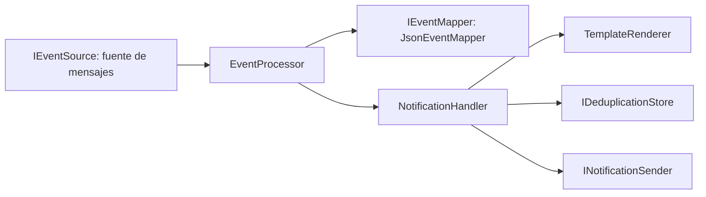

# Servicio de Notificaciones

Microservicio independiente (.NET 10) que avisa al usuario cuando otro servicio se lo pide, con una llamada HTTP o con un mensaje de Service Bus. No conoce reservas, pagos ni asientos, y tampoco quién lo llama ni qué pasa antes o después: recibe un evento, arma el texto con una plantilla y lo entrega.

Corresponde al punto 3.h del trabajo práctico (Grupo 6, dupla 4).

## Estado

| Hecho | Pendiente |
|---|---|
| Núcleo del servicio y puertos de entrada y salida | Probar el lector de Service Bus contra Azure real: falta acordar y crear la suscripción |
| Fuente de mensajes simulada, con mensajes de ejemplo | Envío real del aviso (mail o push); hoy sale por consola |
| Lector de Azure Service Bus, probado con el emulador oficial | Almacén compartido de avisos ya enviados (hoy es memoria) |
| Elección de la fuente por configuración | Sumar los servicios de las otras duplas al Compose |
| Traducción del mensaje y plantillas por configuración | Que Booking implemente la llamada HTTP al notificador: hoy no está en su rama |
| Descarte de duplicados y cola de errores | |
| Logs con Serilog, `TraceId` y auditoría de inicio y fin | |
| Entrada HTTP `POST /api/notifications` con el contrato de Booking | |
| Pruebas unitarias y de la entrada HTTP (92), Dockerfile e imagen en el Compose | |

## Cómo funciona



1. La fuente entrega un mensaje crudo (`IncomingEvent`) al procesador. La fuente puede ser la simulada, el lector de Service Bus o la entrada HTTP, que convierte la llamada en el mismo `IncomingEvent`.
2. El traductor lo convierte en una solicitud interna (`NotificationRequest`): a quién avisar, de qué tipo y con qué datos.
3. El manejador descarta el aviso si ya lo envió, arma el texto con la plantilla del tipo y lo entrega.
4. El procesador devuelve a la fuente qué hacer con el mensaje: darlo por resuelto, reintentar o apartarlo a la cola de errores.

Solo la fuente y el traductor conocen el transporte y el formato del emisor. El resto del servicio trabaja con la solicitud interna.

## Formato de mensaje que acepta

| Parte del mensaje | Qué se espera | Obligatorio |
|---|---|---|
| `Subject` | El tipo de aviso, por ejemplo `ReservaCreada`. Elige la plantilla | Sí |
| Cuerpo | Un objeto JSON de un solo nivel. Los nombres no distinguen mayúsculas | Sí |
| Campo del destinatario | Un campo del cuerpo (o propiedad del mensaje) cuyo nombre indica `Notifications:Mapping:RecipientField` | Sí |
| `CorrelationId` | Identificador de seguimiento. Se usa en todos los registros de log | No |
| `MessageId` | Identificador del mensaje. Se usa para descartar repetidos si no hay otra clave | No |
| Propiedades del mensaje | Se suman a los datos de la plantilla sin pisar los del cuerpo | No |

Los valores de texto, número y booleano pasan como texto a la plantilla. Los objetos y arreglos pasan como JSON sin interpretar. Los `null` se ignoran.

Ejemplo (el formato que hoy publica Booking):

```json
{
  "TipoEvento": "ReservaCreada",
  "ReservaId": "7c9e6679-7425-40de-944b-e07fc1f90ae7",
  "SolicitudId": "1b4e28ba-2fa1-11d2-883f-0016d3cca427",
  "UsuarioId": "usuario-demo",
  "Estado": "Retenida",
  "FechaVencimientoUtc": "2026-11-01T20:05:00Z",
  "TraceId": "a1f3c0de5b7e4c9f8a2d6e1b3c4d5e6f"
}
```

con `Subject = ReservaCreada` y `CorrelationId = 1b4e28ba-2fa1-11d2-883f-0016d3cca427`.

## Entrada HTTP

El servicio escucha `POST /api/notifications`. Es la llamada que hará Booking: el profesor indicó que la API de notificación no es obligatoria en código y que, si se implementa, conviene una llamada HTTP directa desde Booking en lugar de mezclar tópicos de responsabilidades distintas.

| Parte | Qué se espera |
|---|---|
| Header `x-event-type` | `ReservaCreada` o `ReservaConfirmada`. Elige la plantilla. Si falta, se usa el campo `tipoEvento` del cuerpo |
| Header `x-trace-id` | Identificador de seguimiento. Si falta, se usa el campo `traceId` del cuerpo |
| Cuerpo | Objeto JSON de hasta 64 KB. Es el mismo que Booking ya publica en Service Bus |

```json
{
  "tipoEvento": "ReservaCreada",
  "reservaId": "3fa85f64-5717-4562-b3fc-2c963f66afa6",
  "solicitudId": "7d9e4c12-3456-4789-a123-bcdef0123456",
  "asientoId": "aaaaaaaa-aaaa-aaaa-aaaa-aaaaaaaaaaa1",
  "eventoId": "11111111-1111-1111-1111-111111111111",
  "usuarioId": "user-123",
  "estado": "Retenida",
  "fechaCreacionUtc": "2026-11-05T18:00:00Z",
  "fechaVencimientoUtc": "2026-11-05T18:05:00Z",
  "fechaEventoUtc": "2026-11-05T18:00:00.123Z",
  "traceId": "trace-abc-123"
}
```

Cuando el pago se confirma cambian `tipoEvento` a `ReservaConfirmada` y `estado` a `Confirmada`.

| Respuesta | Cuándo |
|---|---|
| `202 Accepted` | Se envió el aviso, o ya se había enviado y se descartó el repetido |
| `400 Bad Request` | Falta el tipo o el destinatario, el cuerpo no es un objeto JSON o no hay plantilla para el tipo. El cuerpo de la respuesta es `{"error": "..."}` |
| `405 Method Not Allowed` | Cualquier método distinto de `POST` |
| `413 Content Too Large` | El cuerpo supera los 64 KB |
| `503 Service Unavailable` | No se pudo enviar el aviso. El que llama puede reintentar: la reserva se libera y el reintento sí avisa |

- No pide autenticación, porque el contrato acordado no la incluye y el servicio solo se publica en `127.0.0.1` o dentro de la red de Docker.
- Al ser una llamada directa no hay broker que guarde el mensaje: si el notificador está caído, el aviso no llega salvo que el que llama reintente. Booking le da 2 segundos y no debería fallar una reserva por esto.
- El puerto es el 5050: con `dotnet run` lo fija `launchSettings.json` y en Docker, `ASPNETCORE_URLS`. El Compose lo publica solo en `127.0.0.1:5050`, y desde otro contenedor se llama a `http://notification-service:5050`.

```bash
curl -i -X POST http://127.0.0.1:5050/api/notifications \
  -H 'x-event-type: ReservaCreada' -H 'x-trace-id: trace-abc-123' \
  -H 'content-type: application/json' \
  -d '{"tipoEvento":"ReservaCreada","reservaId":"3fa85f64","usuarioId":"user-123","fechaVencimientoUtc":"2026-11-05T18:05:00Z"}'
```

## Qué pasa con cada mensaje

| Situación | Resultado | Qué hace el servicio |
|---|---|---|
| Se envió el aviso | Completado | Lo da por resuelto |
| El aviso ya se había enviado | Completado | No avisa de nuevo y lo registra |
| Falta el `Subject`, el cuerpo no es un JSON de tipo objeto o falta el destinatario | Apartado | Cola de errores, con el motivo y una advertencia en el log |
| No hay plantilla para el tipo | Apartado | Cola de errores, con el motivo y una advertencia en el log |
| Falló el envío | Reintentar | La fuente vuelve a entregarlo. La simulada lo intenta 3 veces y después lo aparta |

Por HTTP, lo mismo se expresa con el código de respuesta: completado es 202, apartado es 400 y reintentar es 503.

La clave del aviso se reserva de forma atómica antes de enviar, así dos copias del mismo mensaje que llegan a la vez avisan una sola vez. Si no se pudo enviar, la reserva se libera y el reintento sí envía.

### Cómo se detectan los duplicados

Service Bus entrega los mensajes al menos una vez, así que uno puede llegar repetido. La clave de cada aviso se arma, en este orden, con:

1. El tipo y los campos de negocio de `Notifications:Mapping:DeduplicationFields` (hoy `ReservaId`), si el mensaje trae todos.
2. El `MessageId`. Un mensaje enviado con el SDK llega con uno aunque el emisor no lo fije (se comprobó con el emulador de Service Bus), pero es aleatorio: sirve para detectar que el broker reentregó el mismo mensaje, no para reconocer dos publicaciones del mismo evento. Para eso están los campos de negocio.
3. Una huella del cuerpo.

## Varios mensajes a la vez

- Procesa cualquier cantidad de mensajes, uno tras otro o en paralelo. Las pruebas cubren 2000 mensajes distintos en secuencia y otros 2000 con 32 en simultáneo, sin pérdidas ni avisos de más.
- Si el mismo mensaje llega varias veces a la vez, se avisa una sola vez.
- La fuente simulada entrega de a un mensaje. Con Service Bus, cuántos se procesan a la vez lo define `ServiceBus:MaxConcurrentCalls`, que por defecto es 1.
- Límites: la memoria de avisos enviados vive en un solo proceso, así que con más de una instancia habría que moverla a un almacén compartido, y crece con cada aviso nuevo mientras el servicio esté activo.

## Configuración

Está en `appsettings.json`. Cualquier valor se puede reemplazar con variables de entorno, por ejemplo `Notifications__Mapping__RecipientField`.

```json
"Notifications": {
  "Mapping": {
    "RecipientField": "UsuarioId",
    "DeduplicationFields": [ "ReservaId" ]
  },
  "Templates": {
    "ReservaCreada": "Tu reserva {ReservaId} quedó retenida hasta {FechaVencimientoUtc}. Pagá antes de que venza para confirmarla.",
    "ReservaConfirmada": "Tu reserva {ReservaId} fue confirmada. ¡Gracias por tu compra!"
  }
}
```

- En una plantilla, `{Campo}` se reemplaza por el dato del mismo nombre. Si el mensaje no lo trae, se escribe `(sin dato)`.
- Un tipo de aviso nuevo es una plantilla más. No hace falta recompilar.
- Si el emisor usa otros nombres de campo, se cambian acá y no en el código.

## Logs

Usa Serilog, configurado en la sección `Serilog` de `appsettings.json`. Cada mensaje abre un contexto con `TraceId`, `CorrelationId`, `Subject` y `DeliveryCount`, y todos los registros del procesamiento lo llevan, también los del manejador y el envío.

- El `TraceId` es la propiedad `TraceId` del mensaje, o el header `x-trace-id` por HTTP. Si el emisor no la manda, se usa el `CorrelationId` o el campo `traceId` del cuerpo.
- Cada mensaje registra su inicio y su fin con los campos de auditoría: `Servicio`, `Etapa`, `Operacion`, `TraceId`, `Resultado` y `DuracionMs`.
- Este servicio es la implementación de referencia de la plantilla de logs del grupo, descrita en `docs/plantilla-de-logs.md`.

```text
23:37:28 INF [NotificationService] [TraceId=a1f3c0de5b7e4c9f8a2d6e1b3c4d5e6f] Inicio ProcesarMensaje
23:37:28 INF [NotificationService] [TraceId=a1f3c0de5b7e4c9f8a2d6e1b3c4d5e6f] AVISO para usuario-demo: Tu reserva 7c9e6679-7425-40de-944b-e07fc1f90ae7 quedó retenida hasta 2026-11-01T20:05:00Z. Pagá antes de que venza para confirmarla.
23:37:28 INF [NotificationService] [TraceId=a1f3c0de5b7e4c9f8a2d6e1b3c4d5e6f] Fin ProcesarMensaje Resultado=Completed DuracionMs=14
23:37:31 INF [NotificationService] [TraceId=1b4e28ba-2fa1-11d2-883f-0016d3cca427] Inicio ProcesarMensaje
23:37:31 WRN [NotificationService] [TraceId=1b4e28ba-2fa1-11d2-883f-0016d3cca427] Mensaje inválido, va a la cola de errores. Motivo: El cuerpo del mensaje no es un JSON válido.
23:37:31 INF [NotificationService] [TraceId=1b4e28ba-2fa1-11d2-883f-0016d3cca427] Fin ProcesarMensaje Resultado=DeadLetter DuracionMs=3
```

El último mensaje no traía `TraceId`, así que se muestra su `CorrelationId`.

## Cómo ejecutarlo

Desde la raíz del repositorio:

```bash
dotnet run --project TP-ProgramacionIV/NotificationService
dotnet test TP-ProgramacionIV/NotificationService.slnx
```

Con Docker:

```bash
docker build -t notification-service TP-ProgramacionIV/NotificationService
docker run --rm -p 127.0.0.1:5050:5050 -e ASPNETCORE_URLS=http://+:5050 notification-service
```

Por defecto el servicio usa la fuente simulada: entrega cuatro mensajes de ejemplo (una reserva creada, una confirmada, la creada repetida y un JSON inválido) y queda activo. No necesita red. La entrada HTTP está siempre activa. Para atender solo por HTTP, sin los mensajes de ejemplo, se configura `EventSource:Type=None` (`NOTIFICATION_SOURCE=None` con el Compose).

Para usar Service Bus se cambia la fuente por configuración, sin tocar el código. Con el Compose, las variables van en el archivo `.env`, que el repositorio ignora:

```text
NOTIFICATION_SOURCE=ServiceBus
SERVICEBUS_CONNECTION_STRING=<cadena de conexión>
SERVICEBUS_SUBSCRIPTION=notification
```

Si se elige Service Bus y falta algún dato, el servicio no arranca: escribe qué falta y termina con código de salida 1.

## Diseño

| Pieza | Principio o patrón | Por qué |
|---|---|---|
| `IEventSource`, `INotificationSender`, `NotificationEndpoint` | Puertos y adaptadores, inversión de dependencias | El núcleo no sabe de dónde llegan los mensajes ni cómo se entrega el aviso. Pasar de la fuente simulada a Service Bus o a HTTP, o de la consola a un mail, es registrar otra clase. La entrada HTTP y el lector de Service Bus convierten su formato en el mismo `IncomingEvent` |
| `JsonEventMapper`, `IncomingEvent` | Capa anticorrupción | Es el único lugar que interpreta el formato del emisor. Lo que cambie del otro lado se absorbe por configuración |
| `NotificationHandler` | Responsabilidad única | Decide qué hacer con un aviso, sin saber del transporte ni del formato |
| `NotificationOptions`, `TemplateRenderer` | Patrón Options, abierto/cerrado | Sumar un tipo de aviso es configuración, no código |
| `IDeduplicationStore` | Entrega al menos una vez, idempotencia | Evita avisar dos veces. Es una interfaz para cambiar el almacenamiento |
| Cola de errores | Resiliencia | Lo que no se puede procesar nunca se aparta con su motivo en lugar de perderse o reintentarse sin fin |

El código no lleva comentarios. Las justificaciones están en esta tabla y en el registro de cambios del proyecto.

## Service Bus

`ServiceBusEventSource` recibe los mensajes de una suscripción con `ServiceBusProcessor`, con la confirmación automática apagada. Cada mensaje se resuelve según el resultado del procesamiento:

| Resultado | Qué hace con el mensaje en el broker |
|---|---|
| Completado | Lo completa |
| Reintentar | Lo abandona. El broker lo vuelve a entregar y, al superar el máximo de entregas de la suscripción, lo manda a su cola de errores |
| Apartar | Lo manda a la cola de errores con la razón `NoProcesable` y el motivo como descripción, recortado a 1000 caracteres |

Si el procesamiento falla con un error inesperado, el mensaje se abandona y el error se registra. Al detener el servicio se deja de recibir mensajes de forma ordenada.

### Configuración

| Clave | Por defecto | Para qué sirve |
|---|---|---|
| `EventSource:Type` | `Fake` | `Fake` usa la fuente simulada, `ServiceBus` usa el broker y `None` no lee de ningún lado, para atender solo por HTTP |
| `ServiceBus:ConnectionString` | vacío | Cadena de conexión. No va en el repositorio: se pasa por variable de entorno (`ServiceBus__ConnectionString`) o `user-secrets` |
| `ServiceBus:TopicName` | vacío | Topic. Si falta, se toma el `EntityPath` de la cadena de conexión |
| `ServiceBus:SubscriptionName` | `notification` | Suscripción propia del notificador |
| `ServiceBus:MaxConcurrentCalls` | `1` | Mensajes que se procesan a la vez |

La cadena de conexión nunca se escribe en los logs ni en los mensajes de error.

### Qué se probó

- **Con el emulador oficial de Service Bus**, con la estructura que se propone para Azure: un topic y dos suscripciones, una de ellas con un filtro por tipo de mensaje. La prueba se hizo fuera del repositorio, con la imagen `mcr.microsoft.com/azure-messaging/servicebus-emulator`:
  - la conexión y la recepción con el SDK real;
  - dos avisos con el texto correcto y el `TraceId` de la propiedad del mensaje, un repetido descartado, y dos mensajes no procesables en la cola de errores del broker, con la razón `NoProcesable` y su motivo;
  - que un mensaje de otro tipo no llegue a la suscripción del notificador por el filtro, y sí a la de Booking;
  - los reintentos: un mensaje abandonado se vuelve a entregar con el contador de entregas en aumento, y uno que siempre falla lo manda el broker a la cola de errores al llegar al máximo, con la razón `MaxDeliveryCountExceeded`;
  - la parada ordenada, con código de salida 0.
- Probado sin conexión: la conversión del mensaje, la decisión de completar, abandonar o apartar, la validación de la configuración, la elección de la fuente, y que el servicio termine con código 1 y un mensaje claro cuando falta configuración.
- **No probado: el servicio de Azure.** El emulador imita su comportamiento pero no es idéntico. Falta una suscripción real donde probarlo.

### Acuerdos pendientes con el grupo

Solo si se usa Service Bus como entrada. Con la llamada HTTP de Booking no hacen falta.

- **Topic y suscripción.** Booking publica hoy en un topic llamado `notificaciones-reserva` (estado al 2026-11-01). El notificador necesita su propia suscripción en el topic que se acuerde.
- **`MessageId`.** Booking no lo fija y llega uno aleatorio. El servicio descarta repetidos con los campos de negocio igualmente, pero fijarlo como `{ReservaId}:{TipoEvento}` permitiría que también el broker reconozca dos publicaciones del mismo evento.
- **Seguimiento.** Booking genera un `TraceId` nuevo en cada publicación. Para seguir una reserva de punta a punta se usa el `CorrelationId`, que lleva el identificador de la solicitud.
