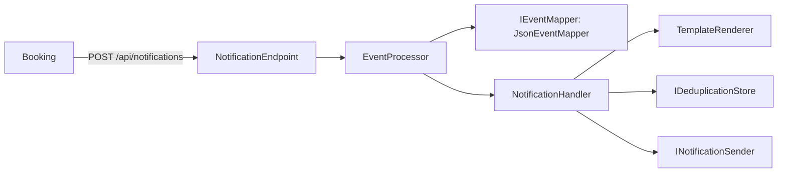

# Servicio de Notificaciones

Microservicio independiente (.NET 10) que avisa al usuario cuando otro servicio se lo pide con una llamada HTTP. No conoce reservas, pagos ni asientos, y tampoco quién lo llama ni qué pasa antes o después: recibe un evento, arma el texto con una plantilla y lo entrega.

Corresponde al punto 3.h del trabajo práctico (Grupo 6, dupla 4). El profesor indicó que la API de notificación no es obligatoria en código y que, si se implementa, conviene una llamada HTTP directa desde Booking, sin mezclar tópicos de Service Bus.

## Estado

| Hecho | Pendiente |
|---|---|
| Entrada HTTP `POST /api/notifications` con el contrato de Booking, que ya la usa | Encender la validación del token: que Booking mande el token y que el realm agregue la audiencia `notifications-api` a su cliente |
| Traducción del evento y plantillas por configuración | Envío real del aviso (mail o push): hoy sale por consola |
| Descarte de duplicados | Almacén compartido de avisos ya enviados (hoy es memoria) |
| Logs con Serilog, `TraceId` y auditoría de inicio y fin | |
| Validación opcional del token de Keycloak (punto 3.e), apagada por defecto | |
| Pruebas (57), Dockerfile y prueba de humo con Docker | |

## Cómo funciona



1. El endpoint convierte la llamada en un `IncomingEvent` y se lo entrega al procesador.
2. El traductor lo convierte en una solicitud interna (`NotificationRequest`): a quién avisar, de qué tipo y con qué datos.
3. El manejador descarta el aviso si ya lo envió, arma el texto con la plantilla del tipo y lo entrega.
4. El procesador devuelve el resultado y el endpoint lo traduce a un código HTTP.

Solo el endpoint y el traductor conocen el formato del emisor. El resto del servicio trabaja con la solicitud interna.

## Entrada HTTP

El servicio escucha `POST /api/notifications`.

| Parte | Qué se espera |
|---|---|
| Header `x-event-type` | `ReservaCreada` o `ReservaConfirmada`. Elige la plantilla. Si falta, se usa el campo `tipoEvento` del cuerpo |
| Header `x-trace-id` | Identificador de seguimiento. Si falta, se usa el campo `traceId` del cuerpo |
| Cuerpo | Objeto JSON de un solo nivel, de hasta 64 KB. Los nombres de campo no distinguen mayúsculas |

```json
{
  "tipoEvento": "ReservaCreada",
  "reservaId": "3fa85f64-5717-4562-b3fc-2c963f66afa6",
  "solicitudId": "7d9e4c12-3456-4789-a123-bcdef0123456",
  "asientoId": "aaaaaaaa-aaaa-aaaa-aaaa-aaaaaaaaaaa1",
  "eventoId": "11111111-1111-1111-1111-111111111111",
  "usuarioId": "user-123",
  "estado": "Retenida",
  "fechaCreacionUtc": "2026-11-05T18:00:00Z",
  "fechaVencimientoUtc": "2026-11-05T18:05:00Z",
  "fechaEventoUtc": "2026-11-05T18:00:00.123Z",
  "traceId": "trace-abc-123"
}
```

Cuando el pago se confirma cambian `tipoEvento` a `ReservaConfirmada` y `estado` a `Confirmada`.

| Respuesta | Cuándo |
|---|---|
| `202 Accepted` | Se envió el aviso, o ya se había enviado y se descartó el repetido |
| `400 Bad Request` | Falta el tipo o el destinatario, el cuerpo no es un objeto JSON o no hay plantilla para el tipo. El cuerpo de la respuesta es `{"error": "..."}` |
| `405 Method Not Allowed` | Cualquier método distinto de `POST` |
| `413 Content Too Large` | El cuerpo supera los 64 KB |
| `503 Service Unavailable` | No se pudo enviar el aviso. El que llama puede reintentar: la clave se libera y el reintento sí avisa |

- Autenticación: por defecto no pide token, porque el contrato acordado con Booking no lo incluye y el servicio solo se publica en `127.0.0.1` o dentro de la red de Docker. La validación del token de Keycloak está implementada y se enciende por configuración (ver el apartado siguiente).
- Al ser una llamada directa no hay broker que guarde el evento: si el notificador está caído, el aviso no llega salvo que el que llama reintente. Booking le da 2 segundos y no debería fallar una reserva por esto.
- El puerto es el 5050: con `dotnet run` lo fija `launchSettings.json` y en Docker, `ASPNETCORE_URLS`. Conviene publicarlo solo en `127.0.0.1:5050`. Dentro del Compose del grupo, otro contenedor lo llama a `http://notification-service:5050`.

```bash
curl -i -X POST http://127.0.0.1:5050/api/notifications \
  -H 'x-event-type: ReservaCreada' -H 'x-trace-id: trace-abc-123' \
  -H 'content-type: application/json' \
  -d '{"tipoEvento":"ReservaCreada","reservaId":"3fa85f64","usuarioId":"user-123","fechaVencimientoUtc":"2026-11-05T18:05:00Z"}'
```

### Autenticación opcional (punto 3.e)

Con `Authentication__Enabled=true` el endpoint exige un token Bearer de Keycloak: valida la firma, el emisor y el vencimiento, y que el cliente que lo pide (el claim `azp`) esté en `AllowedClients`. Sin token responde `401` y con el token de otro cliente, `403`. Viene apagada para no romper el aviso de Booking, que hoy no manda token.

| Clave (sección `Authentication`) | Por defecto | Para qué sirve |
|---|---|---|
| `Enabled` | `false` | Enciende la validación |
| `Authority` | `http://localhost:8080/realms/reservas-realm` | Dirección del realm, de donde se bajan las claves de firma |
| `ValidIssuer` | vacío | Emisor esperado en el token. Si está vacío se usa `Authority`. Dentro del Compose hace falta, porque Keycloak firma con `http://localhost:8080` |
| `ValidateAudience` y `Audience` | `false` y `notifications-api` | Para exigir la audiencia hay que agregar al realm un mapeo de audiencia |
| `AllowedClients` | `[ "booking-api" ]` | Clientes de Keycloak que pueden llamar |
| `RequireHttpsMetadata` | `false` | Desarrollo local sin HTTPS |

Para encenderla hacen falta dos cambios fuera de este servicio: que Booking pida su token a Keycloak y lo mande en el header `Authorization: Bearer`, y, si se quiere exigir la audiencia, que el realm agregue `notifications-api` a los tokens de `booking-api`.

## Qué pasa con cada evento

| Situación | Resultado | Respuesta |
|---|---|---|
| Se envió el aviso | Completado | 202 |
| El aviso ya se había enviado | Completado: no avisa de nuevo y lo registra | 202 |
| Falta el tipo, el cuerpo no es un objeto JSON o falta el destinatario | Rechazado, con el motivo y una advertencia en el log | 400 |
| No hay plantilla para el tipo | Rechazado, con el motivo y una advertencia en el log | 400 |
| Falló el envío | Reintentar | 503 |

La clave del aviso se reserva de forma atómica antes de enviar, así dos llamadas iguales a la vez avisan una sola vez. Si no se pudo enviar, la reserva se libera y el reintento sí envía.

### Cómo se detectan los duplicados

La clave de cada aviso se arma, en este orden, con:

1. El tipo y los campos de negocio de `Notifications:Mapping:DeduplicationFields` (hoy `ReservaId`), si el evento trae todos.
2. Una huella del cuerpo.

## Varios eventos a la vez

- Procesa cualquier cantidad de llamadas, una tras otra o en paralelo. Las pruebas cubren 2000 eventos distintos en secuencia y otros 2000 con 32 en simultáneo, sin pérdidas ni avisos de más.
- Si el mismo evento llega varias veces a la vez, se avisa una sola vez.
- Límites: la memoria de avisos enviados vive en un solo proceso, así que con más de una instancia habría que moverla a un almacén compartido, y crece con cada aviso nuevo mientras el servicio esté activo.

## Configuración

Está en `appsettings.json`. Cualquier valor se puede reemplazar con variables de entorno, por ejemplo `Notifications__Mapping__RecipientField`.

```json
"Notifications": {
  "Mapping": {
    "RecipientField": "UsuarioId",
    "DeduplicationFields": [ "ReservaId" ]
  },
  "Templates": {
    "ReservaCreada": "Tu reserva {ReservaId} quedó retenida hasta {FechaVencimientoUtc}. Pagá antes de que venza para confirmarla.",
    "ReservaConfirmada": "Tu reserva {ReservaId} fue confirmada. ¡Gracias por tu compra!"
  }
}
```

- En una plantilla, `{Campo}` se reemplaza por el dato del mismo nombre. Si el evento no lo trae, se escribe `(sin dato)`.
- Un tipo de aviso nuevo es una plantilla más. No hace falta recompilar.
- Si el emisor usa otros nombres de campo, se cambian acá y no en el código.

## Logs

Usa Serilog, configurado en la sección `Serilog` de `appsettings.json`. Cada llamada abre un contexto con `TraceId`, `CorrelationId` y `Subject`, y todos los registros del procesamiento lo llevan, también los del manejador y el envío.

- El `TraceId` es el header `x-trace-id`. Si no viene, se usa el campo `traceId` del cuerpo.
- Cada llamada registra su inicio y su fin con los campos de auditoría: `Servicio`, `Etapa`, `Operacion`, `TraceId`, `Resultado` y `DuracionMs`.
- Este servicio es la implementación de referencia de la plantilla de logs del grupo, descrita en `docs/plantilla-de-logs.md`.

```text
21:45:13 INF [NotificationService] [TraceId=trace-red-1] Inicio ProcesarMensaje
21:45:13 INF [NotificationService] [TraceId=trace-red-1] AVISO para user-123: Tu reserva r-red-1 fue confirmada. ¡Gracias por tu compra!
21:45:13 INF [NotificationService] [TraceId=trace-red-1] Fin ProcesarMensaje Resultado=Completed DuracionMs=0
```

## Cómo ejecutarlo

Desde la raíz del repositorio:

```bash
dotnet run --project TP-ProgramacionIV/NotificationService
dotnet test TP-ProgramacionIV/NotificationService.Tests/NotificationService.Tests.csproj
```

Con Docker:

```bash
docker build -t notification-service TP-ProgramacionIV/NotificationService
docker run --rm -p 127.0.0.1:5050:5050 notification-service
```

Prueba de humo, que construye la imagen, levanta el servicio en `127.0.0.1:5050`, llama al endpoint y lo apaga:

```bash
./scripts/smoke-test.sh
```

En el Compose del grupo el servicio se llama `notification-service`, escucha en el puerto 5050 y no necesita ninguna variable de entorno ni base de datos.

## Diseño

| Pieza | Principio o patrón | Por qué |
|---|---|---|
| `NotificationEndpoint`, `HttpEventMapper` | Puertos y adaptadores | Son el único lugar que conoce HTTP: convierten la llamada en un `IncomingEvent` y el resultado en un código de respuesta. Otra entrada sería otro adaptador junto a este |
| `INotificationSender` | Puertos y adaptadores, inversión de dependencias | El núcleo no sabe cómo se entrega el aviso. Pasar de la consola a un mail es registrar otra clase |
| `JsonEventMapper`, `IncomingEvent` | Capa anticorrupción | Es el único lugar que interpreta el formato del emisor. Lo que cambie del otro lado se absorbe por configuración |
| `NotificationHandler` | Responsabilidad única | Decide qué hacer con un aviso, sin saber del transporte ni del formato |
| `NotificationOptions`, `TemplateRenderer` | Patrón Options, abierto/cerrado | Sumar un tipo de aviso es configuración, no código |
| `IDeduplicationStore` | Idempotencia | Evita avisar dos veces si el que llama reintenta. Es una interfaz para cambiar el almacenamiento |

Como pide el enunciado, las decisiones y los patrones se justifican en el código con comentarios breves, marcados con `[JUSTIFICACIÓN - ...]`, en las clases principales. Esta tabla las resume.
