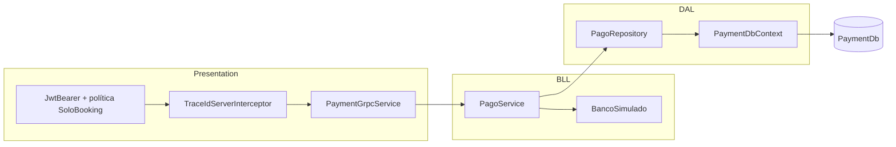

# Payment gRPC API

Microservicio que cobra las reservas retenidas. Booking lo llama por gRPC, Payment decide con un banco simulado y guarda cada cobro en su propia base, aprobado o rechazado. Es idempotente: si el mismo cobro llega dos veces, devuelve el resultado guardado sin volver a cobrar.

Corresponde al punto 3.c del trabajo práctico (Grupo 6, dupla 3). La arquitectura, los diagramas y la resiliencia del lado de Booking están en [`docs/feature-3-pagos.md`](../../docs/feature-3-pagos.md).

## Estado

| Hecho | Pendiente |
|---|---|
| Contrato gRPC v1 compartido con Booking | Sumarlo al compose del grupo cuando la rama de dupla 4 entre a develop |
| N-Layer con dominio anémico y base PostgreSQL propia | Mapper de audiencia `payment-api` en el realm del grupo |
| Cobro idempotente por `ReservaId`, resuelto con un índice UNIQUE | |
| Banco simulado configurable | |
| Validación del token de Keycloak y autorización solo para Booking | |
| `TraceId` y logs de inicio y fin con la plantilla de dupla 4 | |
| 31 pruebas automáticas, Dockerfile y compose | |

## Capas



| Capa | Carpeta | Qué hace |
|---|---|---|
| Presentation | `Presentation/` | Valida el token, toma el `TraceId`, valida la entrada y traduce entre el contrato gRPC y la BLL. Decide qué status gRPC corresponde a cada error |
| BLL | `BLL/` | La regla de idempotencia y el banco simulado. No sabe que del otro lado hay gRPC |
| DAL | `DAL/` | La entidad `Pago`, que solo tiene datos, el `DbContext` con el índice UNIQUE, el repositorio y las migraciones |

## Contrato

El contrato es [`TP-ProgramacionIV/Protos/payment/v1/payment.proto`](../Protos/payment/v1/payment.proto). Payment genera el servidor y Booking el cliente, los dos desde el mismo archivo.

`ProcesarPago` recibe `reserva_id`, `solicitud_id`, `usuario_id` y `monto_centavos` (int64). Además, en la metadata, recibe `authorization: Bearer <token>` y `x-trace-id`. Responde así:

| Caso | Respuesta | En Booking |
|---|---|---|
| Aprobado | OK, `RESULTADO_PAGO_APROBADO` | Confirmada |
| Fondos insuficientes | OK, `RESULTADO_PAGO_RECHAZADO_FONDOS_INSUFICIENTES` y el motivo | Rechazada por PagoFallido |
| Misma reserva otra vez, mismos datos | OK, el mismo `transaccion_id` que la primera vez | Según el resultado guardado |
| Misma reserva con otro monto u otro usuario | `FailedPrecondition` | PagoNoDisponible |
| Pedido mal formado | `InvalidArgument` | PagoNoDisponible |
| Sin token o token inválido (firma, emisor o vencimiento). También sin audiencia `payment-api`, si `ValidateAudience` está en `true` | `Unauthenticated` | PagoNoDisponible |
| Token de otro cliente del realm | `PermissionDenied` | PagoNoDisponible |
| Base caída | `Unavailable`, que Booking reintenta | PagoNoDisponible si no se recupera |
| Error inesperado | `Internal`, sin detalles | PagoNoDisponible |

## Configuración

En `appsettings.json`, o por variables de entorno con `__`, por ejemplo `BancoSimulado__RetardoMs=3000`.

| Clave | Por defecto | Para qué |
|---|---|---|
| `ConnectionStrings:PaymentDb` | Vacía. En Development, `localhost:5433` | Base propia. Conviene sumar `GSS Encryption Mode=Disable`: sin eso, Npgsql intenta Kerberos y deja un error en el log |
| `Authentication:Authority` | `http://localhost:8080/realms/reservas-realm` | De dónde se bajan las claves del realm. En Docker, `http://keycloak:8080/...` |
| `Authentication:ValidIssuer` | Igual que `Authority` | El emisor que figura en el token. Con `KC_HOSTNAME=http://localhost:8080`, es `localhost` aunque Payment consulte por `keycloak` |
| `Authentication:ValidateAudience` | `true`. En Development, `false` | Exigir `aud = payment-api`. El realm la agrega a los tokens de `booking-api` |
| `Authentication:AllowedClients` | `["booking-api"]` | Qué clientes de Keycloak pueden cobrar (claim `azp`) |
| `BancoSimulado:LimitePorCobroCentavos` | `5000000` ($50.000) | Por encima, fondos insuficientes. `0` = sin límite |
| `BancoSimulado:UsuariosSinFondos` | `["usuario-sin-fondos"]` | Usuarios a los que siempre se les rechaza |
| `BancoSimulado:RetardoMs` | `0` | Demora del banco, para mostrar el timeout de Booking |
| `Database:MigrarAlIniciar` | `true` | Aplica las migraciones al arrancar |

## Cómo correrlo

Con Docker, desde la raíz del repo y con un `.env` copiado de `.env.example`:

```bash
docker compose -f docker-keycloak-booking-payment.yaml up -d --build
```

Payment escucha en `http://payment:8080` dentro de la red `booking_network` y en `127.0.0.1:5260` desde el equipo.

Sin Docker, con un Postgres de desarrollo en el puerto 5433:

```bash
docker run --rm -d --name payment-db-dev -p 127.0.0.1:5433:5432 -e POSTGRES_DB=PaymentDb -e POSTGRES_USER=payment -e POSTGRES_PASSWORD=payment-dev postgres:16-alpine
```

```bash
dotnet run --project TP-ProgramacionIV/PaymentAPI
```

## Probar una llamada

Con `grpcurl` y el `.proto`, sin reflection. El token es el de `booking-api`, pedido a Keycloak con `client_credentials`:

```bash
grpcurl -plaintext -import-path TP-ProgramacionIV/Protos -proto payment/v1/payment.proto -H "authorization: Bearer $TOKEN" -H "x-trace-id: 3f2c1a9e-0b7d-4c55-9d1e-6a8b2f4c7e10" -d '{"reserva_id":"7c9e6679-7425-40de-944b-e07fc1f90ae7","solicitud_id":"3f2c1a9e-0b7d-4c55-9d1e-6a8b2f4c7e10","usuario_id":"usuario-demo","monto_centavos":150000}' 127.0.0.1:5260 payment.v1.PaymentService/ProcesarPago
```

Si `grpcurl` no está instalado, se puede usar la imagen `fullstorydev/grpcurl`. Hay que montarle los `.proto` y conectarla a la red del compose, donde Payment es `payment:8080`:

```bash
docker run --rm --network reserva-asientos_reservas -v "$PWD/TP-ProgramacionIV/Protos:/protos:ro" fullstorydev/grpcurl:v1.9.3 -plaintext -import-path /protos -proto payment/v1/payment.proto -H "authorization: Bearer $TOKEN" -H "x-trace-id: 3f2c1a9e-0b7d-4c55-9d1e-6a8b2f4c7e10" -d '{"reserva_id":"7c9e6679-7425-40de-944b-e07fc1f90ae7","solicitud_id":"3f2c1a9e-0b7d-4c55-9d1e-6a8b2f4c7e10","usuario_id":"usuario-demo","monto_centavos":150000}' payment:8080 payment.v1.PaymentService/ProcesarPago
```

## Pruebas

```bash
dotnet test TP-ProgramacionIV/PaymentAPI.Tests
```

- **Unitarias:** el banco simulado y `PagoService`, con la idempotencia, la carrera entre dos intentos, el conflicto de datos y la cancelación.
- **De integración:** Payment entero en memoria, con llamadas gRPC reales y tokens firmados en el test. Cubren el token (sin token, de otro cliente, sin audiencia, vencido, con otra firma), el `TraceId`, los fondos insuficientes y la base caída.
- **Contra un Postgres real**, solo si existe `PAYMENT_TEST_PG` con una cadena de conexión: el índice UNIQUE y dos cobros simultáneos de la misma reserva.

## Logs

Con la plantilla de dupla 4. Todas las líneas de una llamada llevan el `TraceId` que mandó Booking, que es el `SolicitudId`:

```text
23:07:10 INF [PaymentAPI] [TraceId=516e5b79-6255-44a7-af9a-f3e778f9e633] Inicio /payment.v1.PaymentService/ProcesarPago
23:07:11 INF [PaymentAPI] [TraceId=516e5b79-6255-44a7-af9a-f3e778f9e633] Pago 2d1356b5-b1a1-4a13-aef7-cd2e042b430f registrado para la reserva e7d8d68a-78ab-4c41-8030-613762cd6359: Aprobado
23:07:11 INF [PaymentAPI] [TraceId=516e5b79-6255-44a7-af9a-f3e778f9e633] Fin /payment.v1.PaymentService/ProcesarPago Resultado=OK DuracionMs=399
```
