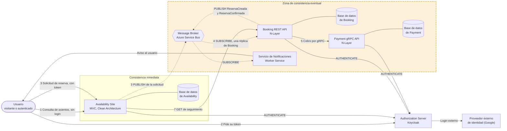
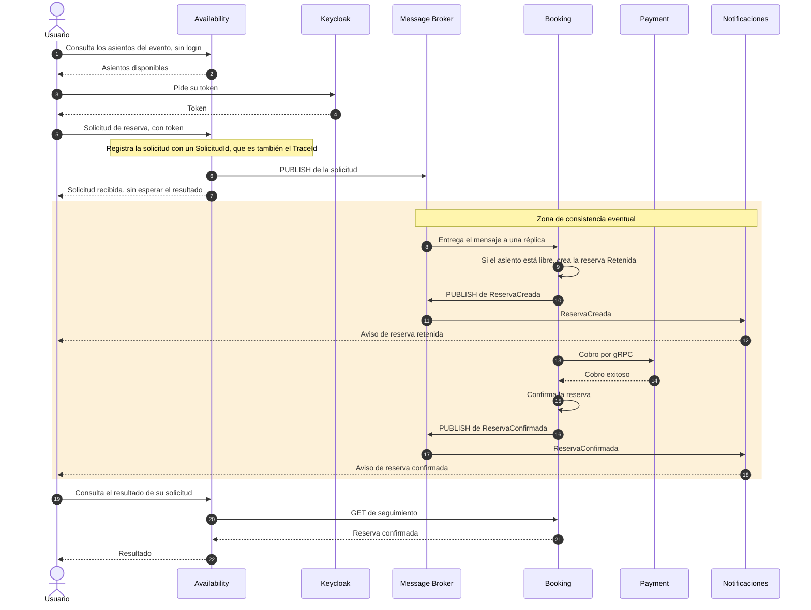
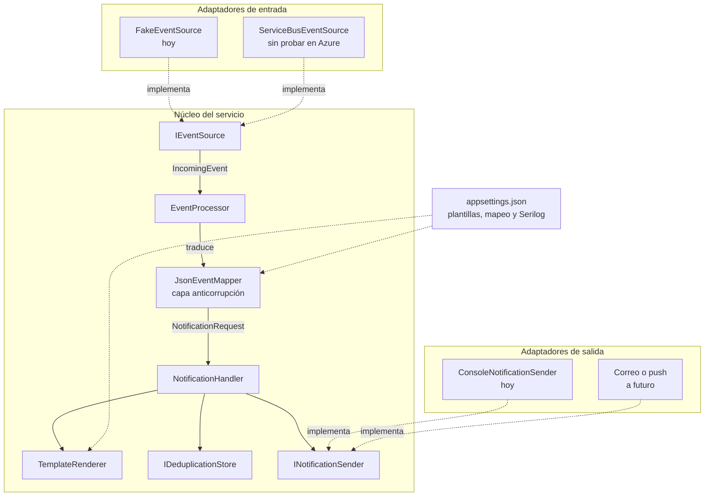

# Arquitectura del sistema de reserva de asientos

Documentación global del Grupo 6, a cargo de la dupla 4. Reúne la tabla de interpretación del diagrama (punto 1), el diagrama general con la zona de consistencia eventual y el servicio de notificaciones (puntos 3.g y 3.h) y el diagrama de arquitectura del servicio de notificaciones (punto 3.i).

El estado de cada componente es el del repositorio al 2026-11-01.

## 1. Diagrama general

Sobre el diagrama del enunciado se agregaron el usuario, el servidor de autorización con su proveedor externo de identidad, el servicio de notificaciones y las publicaciones de Booking al broker. Los números de las flechas son los pasos del flujo de una reserva del enunciado.

### Dónde el sistema se vuelve eventualmente consistente (punto 3.g)

La consistencia eventual empieza en el **PUBLISH de Availability al broker**. A partir de ahí el sistema deja de ser inmediato y converge al estado final con un retraso.

1. **Paso 3, publicación de la solicitud.** Availability responde "recibida" sin esperar el resultado. En ese momento la reserva todavía no existe.
2. **Paso 4, procesamiento.** Una réplica de Booking toma el mensaje cuando puede. Mientras tanto el catálogo que ve el visitante puede mostrar libre un asiento que Booking está por retener.
3. **Pasos 5 y 6, cobro y resultado.** Booking llama a Payment por gRPC, que es una llamada síncrona con tiempo límite, y recién después confirma o rechaza.
4. **Avisos.** Booking publica `ReservaCreada` y `ReservaConfirmada` después de guardar la reserva, y el notificador los procesa más tarde. No frenan la reserva y pueden llegar repetidos o en otro orden.
5. **Paso 7, seguimiento.** El estado que devuelve Booking cambia a medida que avanza el procesamiento: Retenida, y después Confirmada, Rechazada o Vencida.
6. **Paso 8, vencimiento.** Una reserva retenida sin resultado pasa a vencida y libera el asiento después de su tiempo de retención.

Quedan **fuera de la zona**, porque son inmediatas, la consulta de asientos y el registro de la solicitud en Availability.

## 2. Tabla de interpretación del diagrama (punto 1)

| Componente | Rol | Justificación de su participación | Dominio | Arquitectura y tecnología | Estado en el repositorio |
|---|---|---|---|---|---|
| **Public IP Addresses** | Entrada pública al sistema | Es el punto por el que llegan los visitantes. Solo Availability atiende al público: Booking y Payment quedan detrás y se alcanzan a través de él | Acceso de los visitantes | Red | No aplica |
| **Availability Site** | Sitio público: catálogo de eventos y asientos, y entrada de las solicitudes de reserva | Separa lo que ve el usuario, que es lectura y no requiere sesión, de la lógica de reserva. Verifica que el asiento exista, registra la solicitud con un identificador único, la publica en el broker y responde de inmediato "recibida". Así la experiencia del visitante no depende del procesamiento lento y concurrente. Después consulta a Booking el resultado | **Evento** y **Asiento**, en su catálogo, y la solicitud de reserva | ASP.NET Core MVC con Razor. Clean Architecture (Domain, Application, Infrastructure, Web). Dominio anémico. Base SQL según el diagrama | Casos de uso, cliente HTTP hacia Booking y vistas. Todavía no publica en el broker |
| **Message Broker** | Intermediario de mensajes entre servicios | Recibe las solicitudes de Availability y se las entrega a una réplica de Booking. Desacopla en el tiempo a los dos servicios, absorbe los picos de demanda y permite varias réplicas de Booking que se reparten el trabajo. También transporta los eventos hacia el servicio de notificaciones. Es la frontera donde el sistema pasa a ser eventualmente consistente | **Mensaje**: lo que viaja por el broker | Azure Service Bus, con un topic y suscripciones | El topic existe. Falta acordar los topics y las suscripciones de cada servicio |
| **Booking REST API** | Procesa las solicitudes y es dueña del estado de las reservas | Toma el mensaje y crea la reserva Retenida si el asiento está libre, o la rechaza si está ocupado, controlando la concurrencia. Llama a Payment para cobrar y confirma o rechaza según la respuesta. Vence las reservas retenidas que no llegan a un resultado y expone el seguimiento a Availability. Publica los eventos de reserva creada y confirmada | **Reserva** (Retenida, Confirmada, Rechazada, Vencida) y la ocupación del **Asiento** | .NET. N-Layer (Presentation, BLL, DAL). Dominio anémico. PostgreSQL con Entity Framework Core. Polly para la resiliencia | Servicio, oyente del broker, publicador, cliente gRPC y proceso de vencimiento, en la rama de la dupla 2 |
| **Payment gRPC API** | Cobra la reserva retenida | Aísla el cobro en un servicio propio con un contrato gRPC. Booking lo llama y confirma o rechaza según su respuesta. Si no está disponible, Booking degrada con elegancia y rechaza la reserva con el motivo "pago no disponible" | **Pago**: la finalización de la renta del asiento | .NET con gRPC. N-Layer. Dominio anémico. Base SQL | Sin código todavía |
| **Authorization Server** | Emite y valida los tokens | Los usuarios obtienen su token para poder reservar, y los microservicios se autentican entre sí con él. Centraliza la seguridad en un solo componente en lugar de repetirla en cada servicio | Transversal | Keycloak en Docker. OAuth2 y OpenID Connect con tokens JWT. Realm `booking-realm`. Los servicios piden su token con `client_credentials` y el sitio usa el flujo de código de autorización | Compose y realm funcionando en el equipo de luc98. El export subido al repositorio está desactualizado y los tokens no traen audiencia |
| **3rd party Identity Provider** | Verifica la identidad del usuario | El servidor de autorización delega el inicio de sesión en un proveedor externo, de modo que el sistema no guarda contraseñas propias | Quien reserva | Google, configurado en Keycloak | Configurado en el realm. Los secretos se definen al importarlo |
| **Servicio de Notificaciones** (agregado, punto 3.h) | Informa al usuario cuando la reserva queda creada y cuando se confirma tras el cobro | Avisar no debe frenar ni acoplarse al flujo de reserva. Es un consumidor independiente del broker: si falla o se demora, la reserva no se afecta. Es genérico: recibe un mensaje con el tipo de aviso, el destinatario y los datos, arma el texto con una plantilla y lo entrega. No conoce reservas ni a quién publica | **Suceso** convertido en aviso para el usuario | .NET 10 Worker Service. Puertos y adaptadores. Serilog | Implementado. El lector de Service Bus está probado con el emulador oficial. Falta probarlo contra Azure real |
| **Bases de datos** | Persistencia propia de cada servicio | Cada microservicio es dueño de sus datos y ninguno lee la base de otro. Se integran por mensajes y por sus APIs, lo que mantiene su independencia | Evento, Asiento, Reserva y Pago, cada uno en su servicio | SQL según el diagrama. Booking usa PostgreSQL | Booking tiene su base. Las demás no están definidas |

### Decisiones del grupo que siguen abiertas

1. **Base de datos de Availability.** La tabla anterior del grupo decía NoSQL y el diagrama del enunciado muestra una base SQL. Hay que confirmarlo con la dupla 1.
2. **Topics y suscripciones del broker.** Availability, Booking y Notificaciones deben acordar sus nombres, y alguien con permisos tiene que crearlos.
3. **Autenticación del notificador.** El punto 3.e pide que los microservicios se autentiquen entre sí con el servidor de autorización. El notificador solo consume mensajes del broker y no llama a otros servicios. Hay que preguntarle al profesor si debe obtener un token igualmente.
4. **Export del realm y audiencias.** El grupo usa el realm `booking-realm`, pero el export subido es de otro llamado `reservas-realm`. Hay que volver a exportarlo, y los tokens necesitan una audiencia, que Booking valida.

## 3. Secuencia de una reserva, camino feliz

La zona sombreada es la de consistencia eventual.

El `TraceId` nace en Availability y acompaña a todos los pasos, como describe [la plantilla de logs](plantilla-de-logs.md). Así se ve el inicio y el fin de la cadena en cada servicio.

## 4. Arquitectura del servicio de notificaciones (punto 3.i)

El servicio sigue una arquitectura de puertos y adaptadores. El núcleo solo conoce interfaces, y el origen de los mensajes y el modo de entrega se cambian registrando otra clase.

| Capa | Responsabilidad |
|---|---|
| Adaptadores de entrada | Obtienen los mensajes del broker y resuelven cada uno según el resultado: darlo por resuelto, reintentarlo o apartarlo a la cola de errores |
| `EventProcessor` | Une la traducción con el manejador, abre el contexto de log con el `TraceId` y registra el inicio y el fin de cada mensaje |
| `JsonEventMapper` | Único lugar que conoce el formato del emisor. Se guía por la configuración |
| `NotificationHandler` | Descarta los avisos repetidos, arma el texto con la plantilla, lo envía y decide si reintentar o apartar |
| Adaptadores de salida | Entregan el aviso. Hoy lo escriben en la consola |

El detalle del servicio, el formato de mensaje que acepta y sus decisiones de diseño están en [su README](../TP-ProgramacionIV/NotificationService/README.md).

## 5. Diagramas de las otras APIs

El punto 3.i pide un diagrama de arquitectura de cada API. En este documento está el del servicio de notificaciones. Los de Availability (Clean Architecture), Booking (N-Layer) y Payment (N-Layer) los aporta cada dupla con su servicio.
