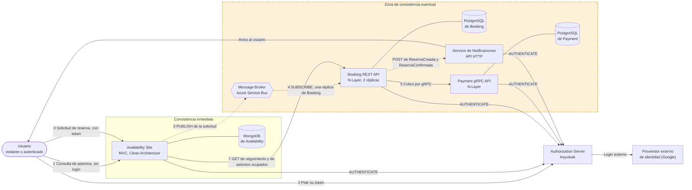
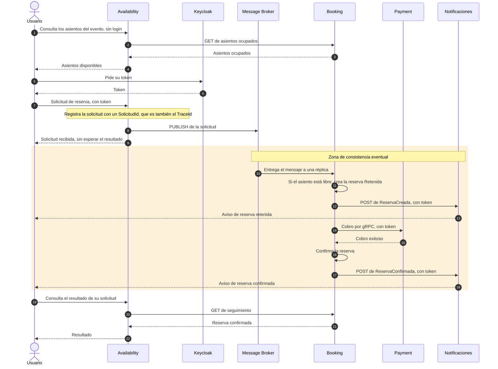

# Arquitectura del sistema de reserva de asientos

Documentación global del Grupo 6. Reúne el diagrama general con la zona de consistencia eventual y el servicio de notificaciones (puntos 3.g y 3.h), la tabla de interpretación del diagrama (punto 1) y el camino a los diagramas de cada API (punto 3.i).

## 1. Diagrama general

Sobre el diagrama del enunciado se agregaron el usuario, el proveedor externo de identidad y el servicio de notificaciones. Los números de las flechas son los pasos del flujo de una reserva.

### Dónde el sistema se vuelve eventualmente consistente (punto 3.g)

La consistencia eventual empieza en el **PUBLISH de Availability al broker**. A partir de ahí el sistema deja de ser inmediato y converge al estado final con un retraso.

1. **Paso 3, publicación de la solicitud.** Availability guarda la solicitud y el mensaje en una misma transacción (outbox) y responde "recibida" sin esperar el resultado. En ese momento la reserva todavía no existe.
2. **Paso 4, procesamiento.** Una réplica de Booking toma el mensaje cuando puede. Mientras tanto, el visitante puede ver libre un asiento que Booking está por retener.
3. **Pasos 5 y 6, cobro y resultado.** Booking llama a Payment por gRPC, una llamada síncrona con tiempo límite, y recién después confirma o rechaza.
4. **Avisos.** Booking llama a Notificaciones después de guardar la reserva. Si no responde, deja una advertencia en el log y la reserva sigue su curso.
5. **Paso 7, seguimiento.** El estado que devuelve Booking cambia a medida que avanza el procesamiento: Retenida, y después Confirmada, Rechazada o Vencida.
6. **Paso 8, vencimiento.** Una reserva retenida sin resultado pasa a Vencida y libera el asiento.

La consulta de asientos combina el catálogo de Availability con los asientos ocupados que informa Booking. Si Booking no responde en 3 segundos se muestra solo el catálogo: la página pública sigue andando y Booking rechaza igual una reserva sobre un asiento ocupado.

## 2. Tabla de interpretación del diagrama (punto 1)

| Componente | Rol | Justificación de su participación | Dominio | Arquitectura y tecnología |
|---|---|---|---|---|
| **Public IP Addresses** | Entrada pública al sistema | Es el punto por el que llegan los visitantes. Solo Availability atiende al público: Booking y Payment quedan detrás | Acceso de los visitantes | Red |
| **Availability Site** | Sitio público: catálogo de eventos y asientos, y entrada de las solicitudes de reserva | Separa lo que ve el usuario, que es lectura y no requiere sesión, de la lógica de reserva. Verifica que el asiento exista, registra la solicitud con un identificador único, la publica en el broker y responde de inmediato "recibida". Después consulta a Booking el resultado | **Evento** y **Asiento**, en su catálogo, y la solicitud de reserva | ASP.NET Core MVC con Razor. Clean Architecture. Dominio anémico. MongoDB con outbox transaccional |
| **Message Broker** | Intermediario de mensajes entre servicios | Recibe las solicitudes de Availability y se las entrega a una réplica de Booking. Desacopla en el tiempo a los dos servicios, absorbe los picos de demanda y permite varias réplicas. Es la frontera donde el sistema pasa a ser eventualmente consistente | **Mensaje**: lo que viaja por el broker | Azure Service Bus, con un topic y una suscripción. En local, su emulador oficial |
| **Booking REST API** | Procesa las solicitudes y es dueña del estado de las reservas | Crea la reserva Retenida si el asiento está libre o la rechaza si está ocupado, controlando la concurrencia. Llama a Payment y confirma o rechaza según la respuesta. Vence las reservas retenidas e informa seguimiento y asientos ocupados a Availability | **Reserva** y ocupación del **Asiento** | .NET. N-Layer (Presentation, BLL, DAL). Dominio anémico. PostgreSQL con Entity Framework Core. Polly para la resiliencia |
| **Payment gRPC API** | Cobra la reserva retenida | Aísla el cobro en un servicio propio con un contrato gRPC. Si no está disponible, Booking rechaza la reserva con el motivo "pago no disponible" en lugar de caerse | **Pago** | .NET con gRPC. N-Layer. Dominio anémico. PostgreSQL. Cobro idempotente por reserva |
| **Authorization Server** | Emite y valida los tokens | Los usuarios obtienen su token para poder reservar, y los microservicios se autentican entre sí con él. Centraliza la seguridad en un solo componente | Transversal | Keycloak. OAuth2 y OpenID Connect con JWT. Realm `reservas-realm`. Los servicios usan `client_credentials` y el sitio el flujo de código de autorización |
| **3rd party Identity Provider** | Verifica la identidad del usuario | El servidor de autorización delega el inicio de sesión en un proveedor externo, de modo que el sistema no guarda contraseñas de usuarios reales | Quien reserva | Google, configurado en Keycloak. Requiere un secreto real, que no va en el repositorio |
| **Servicio de Notificaciones** (agregado, punto 3.h) | Informa al usuario cuando la reserva queda creada y cuando se confirma tras el cobro | Avisar no debe frenar el flujo de reserva: si falla o se demora, la reserva no se afecta. Es genérico: recibe un evento, arma el texto con una plantilla y lo entrega | **Suceso** convertido en aviso | .NET 10. API HTTP protegida con token de Keycloak. Puertos y adaptadores. Serilog |
| **Bases de datos** | Persistencia propia de cada servicio | Cada microservicio es dueño de sus datos y ninguno lee la base de otro. Se integran por mensajes y por sus APIs | Evento, Asiento, Reserva y Pago, cada uno en su servicio | MongoDB en Availability. PostgreSQL en Booking y Payment |

## 3. Secuencia de una reserva, camino feliz

La zona sombreada es la de consistencia eventual.

El `TraceId` nace en Availability y acompaña a todos los pasos, como describe [la plantilla de logs](plantilla-de-logs.md). Así se ve el inicio y el fin de la cadena en cada servicio.

## 4. Diagramas de cada API (punto 3.i)

| API | Diagrama |
|---|---|
| Availability (Clean Architecture) | [`diagramas/Availability.drawio`](diagramas/Availability.drawio) |
| Booking (N-Layer) | [`diagramas/booking-api-rest.drawio`](diagramas/booking-api-rest.drawio) |
| Payment (N-Layer) | [`feature-3-pagos.md`](feature-3-pagos.md) |
| Notificaciones | [`diagramas/diagrama-notificaciones.drawio`](diagramas/diagrama-notificaciones.drawio) |
| Authorization Server | [`diagramas/Diagrama-authorization-server.jpg`](diagramas/Diagrama-authorization-server.jpg) |
