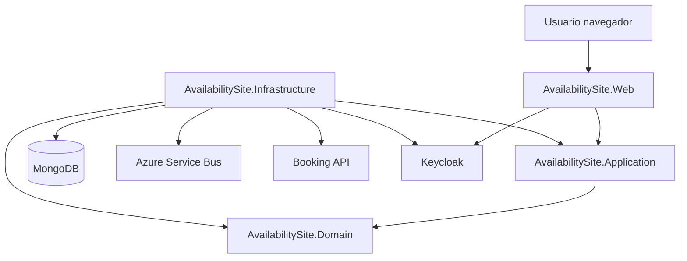
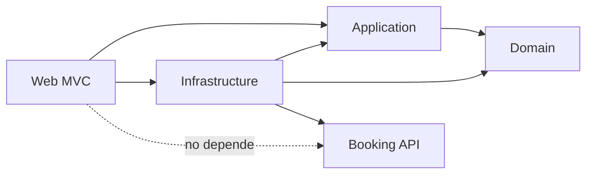
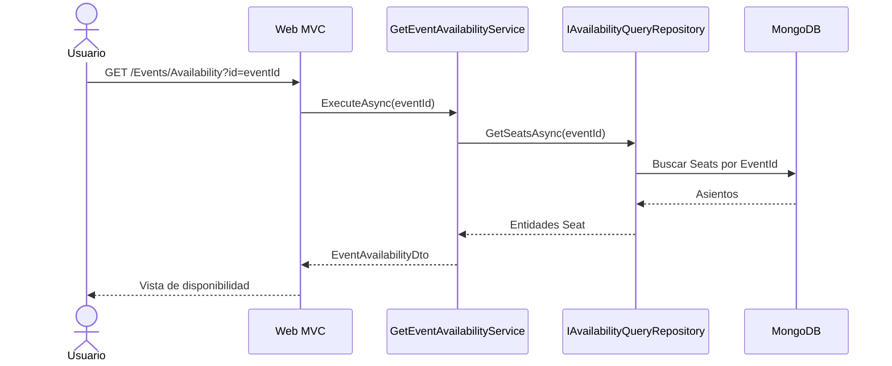
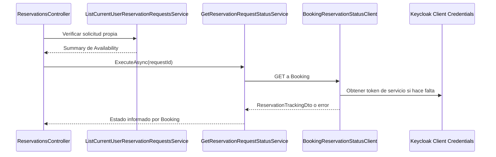
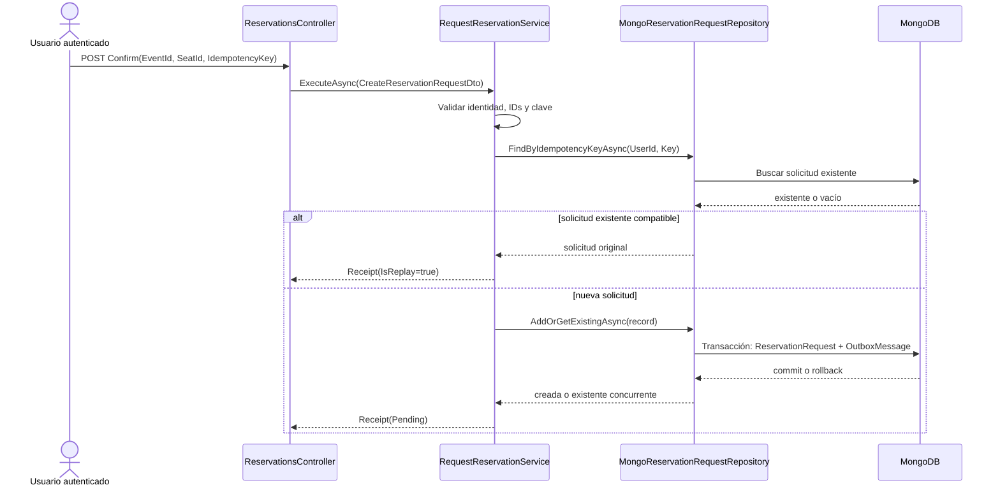
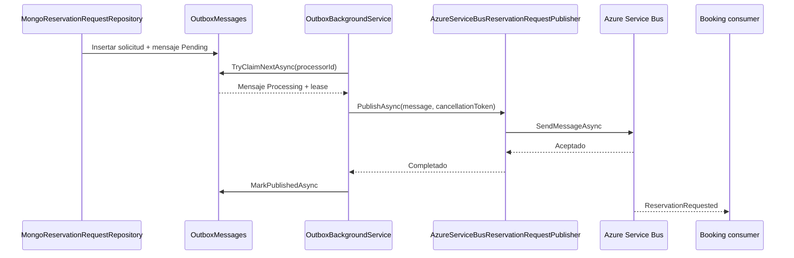
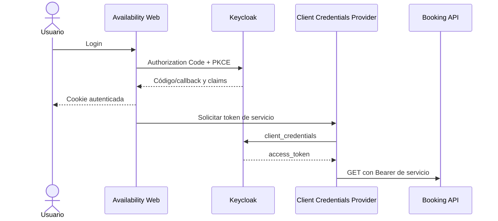

===== 00-README.md =====
# Availability Site — documentación técnica

## Propósito

Availability Site permite consultar eventos y disponibilidad de asientos, registrar solicitudes de reserva y mostrar el seguimiento informado por Booking. La reserva definitiva y la resolución de concurrencia pertenecen a Booking; Availability registra la solicitud, la publica mediante un Outbox y consulta posteriormente su resultado.

## Funcionalidades

- Catálogo público de eventos.
- Consulta pública de disponibilidad.
- Solicitud autenticada de reserva.
- Idempotencia por usuario y `IdempotencyKey`.
- Persistencia MongoDB de solicitudes y mensajes Outbox.
- Publicación asíncrona mediante Azure Service Bus.
- Consulta del estado de una solicitud en Booking REST API.
- Seguimiento MVC con actualización periódica.
- Autenticación de usuarios con Keycloak OIDC.
- Autenticación servicio a servicio con Client Credentials.

## Tecnologías

| Área | Tecnología |
|---|---|
| Runtime | .NET 10 (`net10.0`) |
| Web | ASP.NET Core MVC, Razor |
| Arquitectura | Clean Architecture por proyectos |
| Persistencia | MongoDB.Driver 3.12.0 |
| Mensajería | Azure.Messaging.ServiceBus 7.21.0 |
| Identidad | Keycloak, OpenID Connect, OAuth 2.0 |
| Pruebas | xUnit 2.9.3 |

## Arquitectura resumida



## Índice

1. [Arquitectura](01-arquitectura.md)
2. [Dominio y casos de uso](02-dominio-y-casos-de-uso.md)
3. [Persistencia y MongoDB](03-persistencia-y-mongodb.md)
4. [Solicitudes, idempotencia y Outbox](04-solicitudes-idempotencia-y-outbox.md)
5. [Azure Service Bus](05-integracion-azure-service-bus.md)
6. [Autenticación y autorización](06-autenticacion-y-autorizacion.md)
7. [Booking REST API](07-integracion-booking-api.md)
8. [Frontend MVC](08-frontend-mvc.md)
9. [Configuración y ejecución](09-configuracion-y-ejecucion.md)
10. [Pruebas y validación](10-pruebas-y-validacion.md)
11. [Decisiones y limitaciones](11-decisiones-tecnicas-y-limitaciones.md)

## Estado de validación

La solución compiló con 0 advertencias y 0 errores en la última ejecución registrada. Los tests unitarios de Application pasaron. Las pruebas de integración MongoDB fueron omitidas cuando no había un MongoDB de pruebas disponible. No se presenta como verificado el flujo real con Keycloak, MongoDB Atlas, Azure Service Bus o Booking.


===== 01-arquitectura.md =====
# Arquitectura

## Clean Architecture aplicada

La solución separa el componente en proyectos con responsabilidades distintas:

| Proyecto | Responsabilidad | Dependencias de proyecto |
|---|---|---|
| `AvailabilitySite.Domain` | Entidades anémicas del dominio de Availability | Ninguna |
| `AvailabilitySite.Application` | Casos de uso, DTOs, resultados y abstracciones | Domain |
| `AvailabilitySite.Infrastructure` | MongoDB, Outbox, Azure Service Bus, Keycloak servicio y Booking HTTP | Application, Domain |
| `AvailabilitySite.Web` | MVC, Razor, autenticación de usuario y composición | Application, Infrastructure |

La inversión de dependencias se expresa mediante interfaces en Application. Por ejemplo, Application conoce `IReservationRequestRepository`, pero la implementación concreta es `MongoReservationRequestRepository` en Infrastructure.

## Estructura relevante

```text
AvailabilitySite.Domain/
  Entities/Event.cs
  Entities/Seat.cs

AvailabilitySite.Application/
  Abstractions/
  Availability/
  Common/
  Events/
  Reservations/

AvailabilitySite.Infrastructure/
  Availability/
  Booking/
  Messaging/
  Outbox/
  Persistence/MongoDb/

AvailabilitySite.Web/
  Authentication/
  Composition/
  Controllers/
  Models/
  Presentation/
  Views/
```

## Componentes principales

| Abstracción o servicio | Implementación |
|---|---|
| `IAvailabilityQueryRepository` | `MongoAvailabilityQueryRepository` |
| `IReservationRequestRepository` | `MongoReservationRequestRepository` |
| `IOutboxRepository` | `MongoOutboxRepository` |
| `IReservationRequestPublisher` | `AzureServiceBusReservationRequestPublisher` |
| `IReservationStatusClient` | `BookingReservationStatusClient` |
| `IAccessTokenProvider` | `KeycloakClientCredentialsTokenProvider` |
| `ICurrentUserContext` | `HttpContextCurrentUserContext` |

## Composición y DI

`AvailabilitySite.Web/Program.cs` registra autenticación, `ICurrentUserContext`, `AddAvailabilityInfrastructure`, `AddAvailabilityApplication` y `AddAvailabilityPresentation`.

Application registra como `Scoped`:

- `IGetEventAvailabilityUseCase` → `GetEventAvailabilityService`.
- `IListEventsUseCase` → `ListEventsService`.
- `IGetReservationRequestStatusUseCase` → `GetReservationRequestStatusService`.
- `IRequestReservationUseCase` → `RequestReservationService`.
- `IListCurrentUserReservationRequestsUseCase` → `ListCurrentUserReservationRequestsService`.

Infrastructure registra repositorios Scoped, clientes y publicadores Singleton, el cliente HTTP tipado para Booking y `OutboxBackgroundService` como hosted service.

## Dependencias



La flecha de Infrastructure hacia Application representa implementaciones de abstracciones, no una dependencia de Application hacia detalles técnicos.

## Alcance externo

Booking API, Keycloak, MongoDB y Azure Service Bus están fuera del límite del componente Availability. Sus integraciones están encapsuladas en Infrastructure o en la configuración de Web.


===== 02-dominio-y-casos-de-uso.md =====
# Dominio y casos de uso

## Dominio

`Event` y `Seat` son entidades anémicas:

| Entidad | Propiedades | Responsabilidad |
|---|---|---|
| `Event` | `Id`, `Name` | Representar un evento de Availability |
| `Seat` | `Id`, `EventId`, `Label`, `IsAvailable` | Representar un asiento y su disponibilidad informativa |

La reserva definitiva y la concurrencia no se resuelven en estas entidades; pertenecen a Booking.

Los documentos Mongo agregan `Venue` y `StartsAt` para el catálogo, pero esos campos no forman parte de la entidad Domain `Event`; se exponen mediante `EventSummaryDto`.

## Casos de uso

### `ListEventsService`

Implementa `IListEventsUseCase`, consulta `IAvailabilityQueryRepository.ListEventsAsync` y devuelve `Result<IReadOnlyList<EventSummaryDto>>`.

### `GetEventAvailabilityService`

Implementa `IGetEventAvailabilityUseCase`.

- Rechaza `Guid.Empty` con `Validation`.
- Consulta los asientos del evento.
- Mapea a `SeatAvailabilityDto`.
- Conserva `EventId`, etiqueta y disponibilidad.

### `RequestReservationService`

Implementa `IRequestReservationUseCase`.

- Valida evento, asiento y clave de idempotencia.
- Obtiene el usuario desde `ICurrentUserContext`.
- Busca una solicitud previa por usuario y clave.
- Comprueba que el asiento pertenezca al evento consultado.
- Genera un `Guid` de solicitud.
- Persiste solicitud y Outbox mediante el repositorio.
- Devuelve un recibo `Pending`; no confirma la reserva.

### `GetReservationRequestStatusService`

Implementa `IGetReservationRequestStatusUseCase`, valida `requestId` y delega en `IReservationStatusClient`.

### `ListCurrentUserReservationRequestsService`

Implementa `IListCurrentUserReservationRequestsUseCase`. Requiere identidad autenticada y llama a `ListByUserAsync` usando el `UserId` autenticado.

## DTOs principales

| DTO | Datos |
|---|---|
| `EventSummaryDto` | `EventId`, `Name`, `Venue`, `StartsAt` |
| `EventAvailabilityDto` | `EventId`, colección de `SeatAvailabilityDto` |
| `CreateReservationRequestDto` | `EventId`, `SeatId`, `IdempotencyKey` |
| `ReservationRequestReceiptDto` | `RequestId`, `EventId`, `SeatId`, `ReceivedAt`, `IsReplay`, `Status` |
| `ReservationTrackingDto` | IDs de Booking, `RequestStatus`, `BookingStatus`, rechazo y fechas |
| `ReservationRequestSummaryDto` | solicitud propia, estado local, estado Booking opcional y fecha |

El mensaje `ReservationRequestedMessage` contiene exactamente `SolicitudId`, `EventoId`, `AsientoId` y `UsuarioId`.

## Resultado y errores

`Result<T>` representa éxito o fallo esperado. `ApplicationErrorType` contempla `Validation`, `NotFound`, `Unauthenticated`, `Forbidden`, `DependencyUnavailable` y `OutcomeUnknown`.

Las excepciones quedan para fallos no modelados o infraestructura; la capa Web traduce resultados a páginas HTTP/MVC.

## Flujo de disponibilidad



## Flujo de seguimiento




===== 03-persistencia-y-mongodb.md =====
# Persistencia y MongoDB

## Configuración

La integración está en `AvailabilitySite.Infrastructure.Persistence.MongoDb`.

`MongoDbOptions` utiliza la sección `MongoDB`:

| Opción | Uso |
|---|---|
| `ConnectionString` | Debe llegar desde User Secrets o variables de entorno |
| `DatabaseName` | Base utilizada por `MongoDbContext` |

El contexto registra las colecciones `Events`, `Seats`, `ReservationRequests` y `OutboxMessages`.

## Colecciones y documentos

### `Events`

`EventDocument` usa `EventId` como `_id` y almacena `Name`, `Venue` y `StartsAt` en UTC.

### `Seats`

`SeatDocument` usa `SeatId` como `_id` y almacena `EventId`, `Label` e `IsAvailable`. La disponibilidad es informativa para Availability; Booking gobierna la reserva definitiva.

### `ReservationRequests`

`ReservationRequestDocument` almacena `RequestId`, `EventId`, `SeatId`, `UserId`, `IdempotencyKey`, `RequestStatus` y `CreatedAt`.

### `OutboxMessages`

`OutboxMessageDocument` almacena `MessageId`, `RequestId`, `MessageType`, `Payload`, `CreatedAt`, `PublishedAt`, `Status`, `RetryCount`, `LastError`, `NextAttemptAt`, `LockedBy` y `LockedUntil`.

## Índices reales

`MongoIndexInitializer` crea los siguientes índices:

| Nombre | Colección | Definición |
|---|---|---|
| `ux_seats_event_seat` | Seats | `EventId` + `SeatId`, único |
| `ux_requests_user_idempotency_key` | ReservationRequests | `UserId` + `IdempotencyKey`, único |
| `ix_requests_user_created_at` | ReservationRequests | `UserId` ascendente + `CreatedAt` descendente |
| `ix_outbox_status_created_at` | OutboxMessages | `Status` + `CreatedAt` |
| `ix_outbox_status_next_attempt` | OutboxMessages | `Status` + `NextAttemptAt` |
| `ux_outbox_request_message_type` | OutboxMessages | `RequestId` + `MessageType`, único |

Los identificadores `_id` también tienen unicidad nativa de MongoDB.

## Repositorios

- `MongoAvailabilityQueryRepository` lista eventos, busca un evento, comprueba existencia y obtiene asientos ordenados por etiqueta.
- `MongoReservationRequestRepository` lista solicitudes por usuario y busca por clave de idempotencia.
- `MongoOutboxRepository` consulta, reclama, renueva, publica, falla y reencola mensajes.

Las excepciones MongoDB se traducen mediante `MongoErrors` a `AvailabilityPersistenceException`. Los mensajes mostrables no exponen detalles internos; la excepción original queda para logs.

## Transacciones

`MongoReservationRequestRepository.AddAsync` utiliza una sesión MongoDB y `WithTransactionAsync` con `ReadConcern.Snapshot` y `WriteConcern.WMajority`. En la misma transacción inserta:

1. `ReservationRequestDocument`.
2. `OutboxMessageDocument`.

La implementación requiere un despliegue MongoDB compatible con transacciones, normalmente un replica set o Atlas.

## Estado de validación

La persistencia está implementada en código y tiene pruebas de integración. En las últimas ejecuciones, esas pruebas se omitieron cuando no había MongoDB de pruebas ni Docker. Por lo tanto, no se afirma aquí una conexión real a Atlas ni la ejecución de transacciones sobre datos reales.


===== 04-solicitudes-idempotencia-y-outbox.md =====
# Solicitudes, idempotencia y Transactional Outbox

## Registro de una solicitud

`RequestReservationService` ejecuta este orden:

1. Valida `EventId`, `SeatId` e `IdempotencyKey`.
2. Exige usuario autenticado mediante `ICurrentUserContext`.
3. Busca una solicitud previa por `UserId` y clave.
4. Si existe con los mismos datos, devuelve el recibo con `IsReplay = true`.
5. Si la clave se usó para otro evento o asiento, devuelve `idempotency_key_conflict`.
6. Consulta los asientos del evento y verifica que el asiento pertenezca a ese evento.
7. Genera un único `RequestId`.
8. Crea `ReservationRequestRecord` con estado `Pending`.
9. Persiste solicitud y Outbox mediante `AddOrGetExistingAsync`.
10. Devuelve el recibo; la reserva todavía no está confirmada.

## Idempotencia

La base garantiza unicidad con `UserId + IdempotencyKey`. Esto cubre envíos simultáneos: si dos solicitudes compiten, una inserta y la otra recibe la solicitud existente mediante `DuplicateReservationRequestException` y `AddOrGetExistingAsync`.

La clave pertenece a una operación lógica. El formulario MVC la conserva cuando el resultado de una publicación es incierto para evitar crear otra solicitud.

## Estados

`ReservationRequestStatus` actualmente solo contiene `Pending`. Es el estado local de la solicitud, no el estado definitivo de Booking.

`BookingStatus` se conserva como string informado por Booking. Availability no marca una solicitud como confirmada por haberla persistido o publicado.

## Flujo transaccional



## Outbox

El payload del Outbox es la serialización de `ReservationRequestedMessage`. `OutboxMessageStatus` tiene `Pending`, `Processing`, `Published` y `Failed`.

`OutboxBackgroundService`:

- Reclama atómicamente el siguiente mensaje.
- Renueva el lease aproximadamente cada tercio de su duración.
- Cancela la publicación si pierde el lease.
- Espera la finalización del publisher antes de liberar el scope.
- Marca `Published` solo si conserva la propiedad.
- Registra fallos y solicita reintentos.

La entrega es at-least-once. Si Azure acepta el mensaje y el proceso cae antes de marcarlo como `Published`, Booking puede recibir un duplicado; por eso el consumidor debe ser idempotente por `SolicitudId`.

## Reintentos y recuperación

`OutboxOptions` define `MaxAttempts`, `LeaseDuration`, `RetryBaseDelay` y `MaxRetryDelay`. `MongoOutboxRepository` aplica backoff exponencial limitado, limpia el lease al fallar y permite `RequeueAsync` para mensajes `Failed`.


===== 05-integracion-azure-service-bus.md =====
# Integración con Azure Service Bus

## Responsabilidad

Availability no publica directamente desde el caso de uso. Registra primero el mensaje Outbox. `OutboxBackgroundService` usa posteriormente `IReservationRequestPublisher` para publicar en Azure Service Bus.

## Configuración

`ServiceBusOptions` utiliza la sección `ServiceBus`:

| Opción | Fuente |
|---|---|
| `ConnectionString` | User Secrets o variable de entorno; no se versiona |
| `TopicName` | Configuración externa; en `appsettings.json` aparece `grupo6-booking-topic` |

Availability no configura una subscription: el consumidor y la suscripción pertenecen a Booking o a su infraestructura de mensajería.

## Publicador

`AzureServiceBusReservationRequestPublisher` implementa `IReservationRequestPublisher`. Usa `IServiceBusMessageSender` para desacoplar el SDK en las pruebas.

El mensaje real se construye con:

| Propiedad | Valor |
|---|---|
| Body | JSON PascalCase de `ReservationRequestedMessage` |
| `MessageId` | `SolicitudId.ToString()` |
| `ContentType` | `application/json` |
| `Subject` | `ReservationRequested` |

Ejemplo ficticio:

```json
{
  "SolicitudId": "11111111-1111-1111-1111-111111111111",
  "EventoId": "22222222-2222-2222-2222-222222222222",
  "AsientoId": "33333333-3333-3333-3333-333333333333",
  "UsuarioId": "usuario-keycloak-123"
}
```

No se agregan al contrato de mensajería `IdempotencyKey`, estado ni datos de pago.

## Worker y leases

El worker reclama mensajes con `TryClaimNextAsync`. La actualización es atómica y exige estado disponible o lease vencido. `RenewLeaseAsync`, `MarkPublishedAsync` y `MarkFailedAsync` validan el propietario del mensaje.

Si el lease se pierde, el worker cancela la publicación, espera la tarea del publisher y evita marcar el mensaje como publicado. Si la publicación falla, registra el error y programa un reintento hasta `MaxAttempts`.



## Garantía de entrega

La garantía implementada es at-least-once, no exactly-once. Puede haber duplicados después de una publicación exitosa seguida de una caída antes de actualizar MongoDB. Booking debe deduplicar usando `SolicitudId`.

## Estado de validación

La serialización, cabeceras y cancelación tienen tests unitarios. No se publicó un mensaje real durante la validación disponible y no se verificó la coincidencia efectiva de topic/subscription con Booking.


===== 06-autenticacion-y-autorizacion.md =====
# Autenticación y autorización

Availability utiliza dos mecanismos distintos.

## Usuario: OIDC con Keycloak

`AvailabilitySite.Web/Program.cs` configura cookies y OpenID Connect:

| Configuración | Valor implementado |
|---|---|
| Authority | `Keycloak:Authority` |
| Client ID | `Keycloak:ClientId` |
| Response type | `code` |
| PKCE | Habilitado |
| Callback | `/signin-oidc` |
| Logout callback | `/signout-callback-oidc` |
| Scopes | `openid`, `profile`, `email` |
| Claims | `MapInboundClaims = false` |
| Issuer | Validado contra Authority |

En la configuración versionada, el realm indicado es `reservas-realm`. No se incluyen secretos.

`HttpContextCurrentUserContext` obtiene el identificador desde el claim original `sub`. `RequestReservationService` y `ListCurrentUserReservationRequestsService` rechazan usuarios sin identidad válida.

`AccountController` implementa login y logout. El login usa `kc_idp_hint = google`; la existencia y configuración real del Identity Provider Google dependen de Keycloak.

## Protección MVC

- `HomeController` y `EventsController` son públicos.
- `ReservationsController` tiene `[Authorize]`.
- `TrackStatus` permite el acceso anónimo a nivel de middleware, pero devuelve 401 si no hay sesión para que el polling no sea redirigido a HTML de login.
- `AutoValidateAntiforgeryTokenAttribute` se registra globalmente para POST MVC.

## Servicio a servicio: Client Credentials

`KeycloakClientCredentialsTokenProvider` usa `KeycloakService:Authority`, `ClientId` y `ClientSecret` para solicitar un token con `grant_type=client_credentials`.

- Cachea el access token en memoria.
- Renueva cuando quedan menos de 60 segundos de vigencia.
- Serializa las solicitudes concurrentes mediante `SemaphoreSlim`.
- Devuelve null ante respuesta no exitosa o JSON inválido.

`BookingReservationStatusClient` envía ese token como `Authorization: Bearer` a Booking. Este token no es la cookie ni el token de sesión del usuario.

La audiencia, roles y permisos efectivos dependen de la configuración del realm y de Booking; no se pudieron verificar sin un Authorization Server activo.



## Validación

Los tests cubren `sub`, usuarios anónimos y Client Credentials con doubles. No se verificó login real, discovery, audiencia, roles ni logout contra Keycloak.


===== 07-integracion-booking-api.md =====
# Integración con Booking REST API

## Responsabilidades

| Servicio | Responsabilidad |
|---|---|
| Availability | Registrar la solicitud, conservar su identidad, publicar el mensaje y mostrar seguimiento |
| Booking | Resolver concurrencia, procesar la reserva/pago y determinar el estado definitivo |

Availability no mantiene una máquina local de estados definitivos. `ReservationRequestStatus.Pending` describe la solicitud local; `BookingStatus` refleja el valor devuelto por Booking.

## Cliente HTTP

`BookingReservationStatusClient` se registra mediante `AddHttpClient<IReservationStatusClient, BookingReservationStatusClient>`. La URL base proviene de `Booking:BaseUrl`.

Endpoint implementado:

```text
GET api/reservas/solicitudes/{requestId}
Accept: application/json
Authorization: Bearer <token de servicio>
```

El cliente deserializa internamente una respuesta compatible con `ReservaResultadoDto`:

| Booking | Application |
|---|---|
| `ReservaId` | `ReservaId` |
| `SolicitudId` | `RequestId` |
| `EventoId` | `EventId` |
| `AsientoId` | `SeatId` |
| `Estado` | `BookingStatus` |
| `MotivoRechazo` | `RejectionReason` |
| `FechaCreacionUtc` | `CreatedAtUtc` |
| `FechaVencimientoUtc` | `ExpirationAtUtc` |

## Respuestas HTTP

| Respuesta | Resultado Application |
|---|---|
| 200 | `Result.Success(ReservationTrackingDto)` |
| 404 | `NotFound` |
| 401 | `Unauthenticated` |
| 403 | `Forbidden` |
| Otros 4xx/5xx | `DependencyUnavailable` |
| Timeout | `DependencyUnavailable` con código `booking_timeout` |
| JSON inválido/vacío | `DependencyUnavailable` |
| Cancelación explícita | Se propaga como `OperationCanceledException` |

El endpoint no se prueba contra Booking real en el repositorio de Availability. Los tests usan un `HttpMessageHandler` falso.

## Flujo de seguimiento

```mermaid
sequenceDiagram
    participant W as ReservationsController
    participant A as GetReservationRequestStatusService
    participant C as BookingReservationStatusClient
    participant T as KeycloakService
    participant B as Booking REST API
    W->>A: ExecuteAsync(requestId)
    A->>C: GetAsync(requestId)
    C->>T: Obtener Client Credentials si el token expiró
    T-->>C: access_token
    C->>B: GET /api/reservas/solicitudes/{id}
    alt 200
        B-->>C: ReservaResultadoDto
        C-->>W: ReservationTrackingDto
    else 404
        B-->>C: no existe en Booking
        C-->>W: NotFound; Web muestra Pending local
    else 401/403/5xx
        B-->>C: error
        C-->>W: error de Application
    end
```

## Estados

El frontend reconoce `Retenida`, `Confirmada`, `Rechazada` y `Vencida`, además de alias en inglés. Los textos visibles permanecen en español. Un estado desconocido se muestra como `En proceso` y no se considera terminal.


===== 08-frontend-mvc.md =====
# Frontend MVC y Razor

## Composición

`AvailabilitySite.Web` usa ASP.NET Core MVC con Razor. `Program.cs` configura MVC, autenticación, Application, Infrastructure y `AddAvailabilityPresentation`.

## Controladores y rutas

| Controlador | Acción | Acceso | Caso de uso principal |
|---|---|---|---|
| `HomeController` | `Index` (`/`) | Público | `IListEventsUseCase` |
| `HomeController` | `Privacy` | Público | Ninguno |
| `EventsController` | `Availability` (`/Events/Availability?id=...`) | Público | `IGetEventAvailabilityUseCase` |
| `AccountController` | `Login` GET/POST | Anónimo | Challenge OIDC |
| `AccountController` | `Logout` POST | Anónimo | Sign out cookies/OIDC |
| `ReservationsController` | `Confirm` GET/POST | Autenticado | Availability + `IRequestReservationUseCase` |
| `ReservationsController` | `Index` (`/Reservations`) | Autenticado | Listado propio + seguimiento |
| `ReservationsController` | `Track` (`/Reservations/Track?id=...`) | Autenticado | Seguimiento |
| `ReservationsController` | `TrackStatus` | Sesión comprobada manualmente | Fragmento para polling |

## Flujo de reserva

1. El usuario navega al catálogo.
2. Selecciona un evento y consulta disponibilidad.
3. Selecciona un asiento libre.
4. `Confirm` genera una clave de idempotencia para la operación lógica.
5. El formulario POST incluye evento, asiento y clave.
6. El caso de uso devuelve un recibo pendiente.
7. MVC redirige a `Track` usando `RequestId`.

El mensaje de interfaz aclara que recibir la solicitud no significa que la reserva esté confirmada.

## Seguimiento y polling

`TrackStatus` devuelve el parcial `_TrackingPanel`. `wwwroot/js/tracking.js` realiza consultas con `fetch`, `credentials: same-origin`, backoff temporal y `AbortController`.

El servidor renderiza el estado; JavaScript no replica la máquina de estados. El polling se detiene para estados terminales, 401, 403, 404, página oculta o `pagehide`.

## ViewModels

- `EventListViewModel`: lista de `EventSummaryDto` y error visible.
- `AvailabilityViewModel`: evento, asientos, hora de consulta y preselección.
- `ConfirmReservationViewModel`: formulario y estado de validación.
- `TrackingPageViewModel`: solicitud y `TrackingView`.
- `MyRequestsViewModel`: filas propias con estado.
- `StatusPageViewModel`: página genérica 404/403/400/503.

Los ViewModels envuelven DTOs de Application; no reemplazan sus contratos.

## Seguridad y errores

- Los POST tienen antiforgery automático.
- `Url.IsLocalUrl` evita `ReturnUrl` externo en login.
- Los errores de Application se convierten en páginas o códigos HTTP apropiados.
- `TrackStatus` devuelve texto 401 en vez de una redirección para que el polling pueda detenerse.
- La autorización se aplica al controlador de reservas, no globalmente.

## Validación

La integración de controladores y vistas fue inspeccionada estáticamente. No se realizó una prueba de navegador en esta documentación porque las dependencias externas no estuvieron disponibles.


===== 09-configuracion-y-ejecucion.md =====
# Configuración y ejecución local

## Requisitos

- .NET SDK 10.
- MongoDB compatible con transacciones, preferentemente MongoDB Atlas o replica set de pruebas.
- Keycloak con el realm configurado.
- Azure Service Bus con el topic acordado.
- Booking API accesible.

No es necesario agregar credenciales al repositorio.

## Configuración versionada

`AvailabilitySite.Web/appsettings.json` contiene valores no secretos:

```json
{
  "Keycloak": {
    "Authority": "http://localhost:8080/realms/reservas-realm",
    "ClientId": "availability-site",
    "CallbackPath": "/signin-oidc",
    "SignedOutCallbackPath": "/signout-callback-oidc"
  },
  "KeycloakService": {
    "Authority": "http://localhost:8080/realms/reservas-realm",
    "ClientId": "availability-api"
  },
  "Booking": { "BaseUrl": "http://localhost:5156/" },
  "ServiceBus": { "TopicName": "grupo6-booking-topic" },
  "MongoDB": {
    "DatabaseName": "AvailabilityDb",
    "Outbox": {
      "MaxAttempts": 5,
      "LeaseDuration": "00:00:30",
      "RetryBaseDelay": "00:00:05",
      "MaxRetryDelay": "00:05:00"
    }
  }
}
```

Los siguientes valores deben estar fuera del repositorio:

- `MongoDB:ConnectionString`.
- `ServiceBus:ConnectionString`.
- `KeycloakService:ClientSecret`.

El proyecto tiene `UserSecretsId` configurado. También pueden utilizarse variables de entorno con la convención de configuración de .NET.

## Puertos

Según `launchSettings.json`:

| Perfil | URL |
|---|---|
| HTTP | `http://localhost:5215` |
| HTTPS | `https://localhost:7027` y `http://localhost:5215` |

Booking está configurado con base `http://localhost:5156/` y Keycloak con Authority en `localhost:8080`.

## Comandos

Desde la raíz del repositorio:

```powershell
dotnet restore TP-ProgramacionIV/TP-ProgramacionIV.slnx
dotnet build TP-ProgramacionIV/TP-ProgramacionIV.slnx --no-restore
dotnet run --project TP-ProgramacionIV/AvailabilitySite.Web/AvailabilitySite.Web.csproj
```

Pruebas:

```powershell
dotnet test TP-ProgramacionIV/TP-ProgramacionIV.slnx --no-build --logger "console;verbosity=normal"
```

## Inicio y validación

La aplicación valida al inicio opciones de MongoDB, Booking, Keycloak servicio y Service Bus. Si faltan cadenas o secretos, el contenedor no debe considerarse correctamente configurado.

En la última validación registrada, los User Secrets existían localmente, pero no se expusieron sus valores. Keycloak y Booking no estaban escuchando en sus puertos; las pruebas MongoDB fueron omitidas por falta de un entorno de test habilitado.

## Problemas frecuentes

| Síntoma | Causa probable |
|---|---|
| Fallo de validación de MongoDB | Falta `MongoDB:ConnectionString` |
| Fallo de Service Bus | Falta `ServiceBus:ConnectionString` o topic |
| Token de Booking no disponible | Falta `KeycloakService:ClientSecret` o Keycloak |
| Booking 404 | Solicitud aún no publicada/procesada o inexistente |
| Build bloqueado | Visual Studio o `AvailabilitySite.Web` mantiene DLL abierta |


===== 10-pruebas-y-validacion.md =====
# Pruebas y validación

## Proyectos de pruebas

| Proyecto | Framework | Alcance |
|---|---|---|
| `AvailabilitySite.Application.Tests` | xUnit | Application, Web authentication, Booking client, token provider, publisher y Worker mediante fakes |
| `AvailabilitySite.Infrastructure.IntegrationTests` | xUnit + `Xunit.SkippableFact` | MongoDB, índices, repositorios, transacciones e idempotencia |

## Cobertura unitaria

Los tests cubren:

- Disponibilidad válida, vacía, inválida, cancelación y errores.
- Solicitud válida, usuario anónimo, asiento inexistente e idempotencia.
- Claim `sub` del usuario autenticado.
- Booking 200, 401, 403, 404, JSON inválido, timeout, red y cancelación.
- Client Credentials, caché, renovación y cancelación.
- Serialización de Azure Service Bus.
- Worker, publicación, fallos, leases, renovación y cancelación.
- Mapeo de estados y motivos de Booking en `StatusTexts`.

## Últimos resultados disponibles

En la última ejecución registrada:

- Build de la solución: 0 errores y 0 advertencias.
- `AvailabilitySite.Application.Tests`: 69 correctos.
- `AvailabilitySite.Infrastructure.IntegrationTests`: 1 correcto y 23 omitidos.
- Fallidos: 0.

Los 23 omitidos requieren `AVAILABILITY_MONGODB_TEST_CONNECTION_STRING` o Docker. Docker no fue iniciado. El fixture usa bases con nombre aleatorio y las elimina al finalizar, por lo que debe ejecutarse únicamente en un entorno de pruebas autorizado.

## Niveles de evidencia

| Nivel | Estado |
|---|---|
| Código implementado | Verificado mediante inspección |
| Compilación | Verificada en la ejecución indicada |
| Tests automatizados | Verificados según los conteos anteriores |
| MongoDB real | No verificado en la última ejecución |
| Keycloak real | No verificado |
| Azure Service Bus real | No verificado |
| Booking real | No verificado |
| E2E navegador | No verificado |

No debe interpretarse un test con fake como prueba de conectividad o autorización real.


===== 11-decisiones-tecnicas-y-limitaciones.md =====
# Decisiones técnicas y limitaciones

## Decisiones verificables

### Separación de responsabilidades

Application coordina casos de uso mediante interfaces. Infrastructure concentra detalles de MongoDB, Azure, Keycloak servicio y HTTP. Web traduce casos de uso a MVC/Razor y configura autenticación de usuario.

### Dominio anémico

`Event` y `Seat` representan datos. La validación de solicitudes y coordinación de repositorios están en Application.

### Reserva definitiva en Booking

Availability no confirma reservas. Su estado local inicial es `Pending`; el estado definitivo llega desde Booking.

### Idempotencia

La combinación `UserId + IdempotencyKey` tiene un índice único y el repositorio resuelve carreras devolviendo la solicitud original.

### Transactional Outbox

Solicitud y mensaje se guardan en una única transacción MongoDB. El worker publica después, con leases y reintentos.

### Entrega al menos una vez

La caída entre publicación y `MarkPublishedAsync` puede producir duplicados. No se promete exactly-once; Booking debe deduplicar por `SolicitudId`.

### Separación de tokens

La cookie/OIDC del usuario se separa del token Client Credentials utilizado para Booking.


