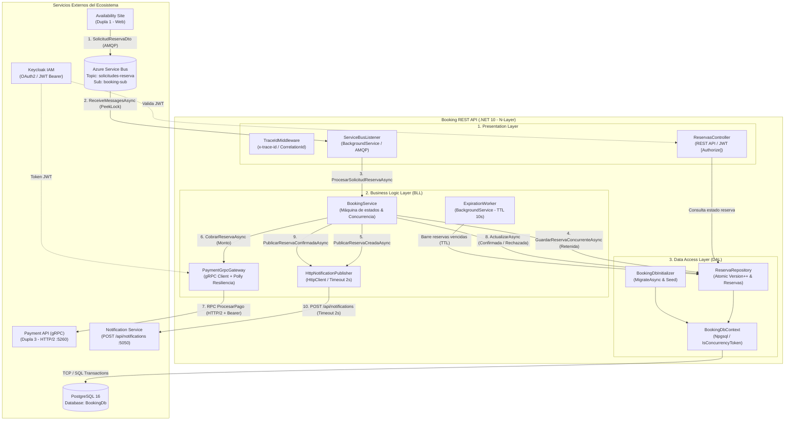

# Booking REST API — Documentación Técnica de Arquitectura

**Responsables (Dupla 2):** Felipe Díaz & Román Ranauro  
**Tecnología:** .NET 10 (`net10.0`), Entity Framework Core 10, PostgreSQL 16, Azure Service Bus, gRPC (HTTP/2), Polly 8, Keycloak JWT.

---

## 1. Introducción y Alcance del Módulo

El microservicio **Booking REST API** es el núcleo transaccional del sistema distribuido de reserva de butacas para eventos. Sus responsabilidades primordiales son:

1. **Consumo Asíncrono de Solicitudes:** Ingesta eventos emitidos por *Availability Site* a través de Azure Service Bus mediante un consumidor con confirmación manual (*settlement* explícito y Dead Letter Queue).
2. **Control de Concurrencia Optimista:** Garantiza que ante colisiones concurrentes (múltiples usuarios compitiendo en el mismo milisegundo por la misma butaca), exactamente **una** reserva sea aceptada y las demás sean rechazadas limpiamente mediante tokens de versión atómicos en PostgreSQL (`Version++`).
3. **Cobro Síncrono Resiliente (gRPC):** Orquesta la llamada a *Payment API* vía gRPC en HTTP/2 protegido por políticas de resiliencia con Polly (Timeout, Reintentos exponenciales y Circuit Breaker).
4. **Expiración Temporal Automática (TTL Worker):** Un worker periódico en segundo plano monitorea y libera asientos retenidos cuya ventana de confirmación haya caducado.
5. **Notificación Desacoplada (HTTP POST):** Emite avisos al *Notification Service* con aislamiento de fallas (timeout estricto y degradación elegante sin cancelar la transacción).
6. **Trazabilidad Distribuida (TraceId):** Propaga un identificador único correlacionado a lo largo de toda la cadena de sucesos (headers HTTP, mensajes AMQP y logs estructurados).

---

## 2. Diagrama de Arquitectura Global y N-Layer

El diagrama editable se encuentra disponible en formato Draw.io en [`docs/booking-api-architecture.drawio`](./booking-api-architecture.drawio).

### Diagrama Mermaid de Arquitectura en Capas



---

## 3. Desglose de Capas (N-Layer)

El proyecto sigue una estricta separación de responsabilidades:

### 3.1. Presentation Layer (`BookingAPI.Presentation`)
* **`Controllers/ReservasController.cs`**: Endpoints REST protegidos con Keycloak (`[Authorize]`) para auditoría y consulta de estados:
  * `GET /api/reservas/{id}`
  * `GET /api/reservas/solicitud/{solicitudId}`
  * `GET /api/reservas/usuario/{usuarioId}`
  * `POST /api/reservas/cancelar/{id}`
* **`Listeners/ServiceBusListener.cs`**: `BackgroundService` que escucha de manera dual (Tópico/Suscripción en Azure, o Cola en desarrollo). Implementa confirmación manual:
  * `CompleteMessageAsync()`: Cuando el mensaje se procesó e insertó con éxito (incluso si resultó rechazada por negocio).
  * `AbandonMessageAsync()`: Ante fallas de infraestructura para permitir reentrega.
  * `DeadLetterMessageAsync()`: Si el payload es corrupto o irrecuperable.
* **`Middlewares/TraceIdMiddleware.cs`**: Lee o genera la cabecera `x-trace-id`, inicializa el scope de logging estructurado (`ILogger.BeginScope`) y mide la duración total de la solicitud.

### 3.2. Business Logic Layer (`BookingAPI.BLL`)
* **`Services/BookingService.cs`**: Orquesta el ciclo de vida de la reserva:
  1. **Idempotencia:** Verifica si `SolicitudId` ya fue procesada; si existe, omite el reprocesamiento.
  2. **Retención Atómica:** Intenta apartar el asiento y guardar la reserva en estado `Retenida` (con TTL de 5 minutos).
  3. **Cobro gRPC:** Si se retiene, invoca sincrónicamente a Payment.
  4. **Transición Final:** Si el cobro es aprobado $\rightarrow$ `Confirmada`. Si es rechazado o Payment está caído $\rightarrow$ `Rechazada` (distinguiendo `PagoFallido` vs `PagoNoDisponible`) y libera el asiento.
* **`Jobs/ExpirationWorker.cs`**: `IHostedService` en segundo plano que corre cada 10 segundos. Busca reservas en `EstadoReserva.Retenida` cuya `FechaVencimientoUtc <= UtcNow`, las transiciona a `EstadoReserva.Vencida` y libera el asiento.
* **`Gateways/PaymentGrpcGateway.cs`**: Cliente gRPC fuertemente tipado generado a partir de `payment.proto`. Integra:
  * **Polly Resilience Pipeline:** Timeout total (10s), Timeout por intento (2s), 2 Reintentos con backoff exponencial y Circuit Breaker (corte de 15s tras 50% de fallas en 30s).
  * **`KeycloakTokenProvider`**: Obtiene token OAuth2 (client credentials) en memoria y lo renueva automáticamente antes de que expire.
* **`Gateways/HttpNotificationPublisher.cs`**: Implementa `IEventPublisher`. Emite avisos mediante `HttpClient` hacia `POST /api/notifications` con timeout estricto de 2s.

### 3.3. Data Access Layer (`BookingAPI.DAL`)
* **`Context/BookingDbContext.cs`**: Contexto de Entity Framework Core configurado para PostgreSQL (`Npgsql`). Configura tokens de concurrencia e índices únicos.
* **`Repositories/ReservaRepository.cs`**: Encapsula las operaciones transaccionales de base de datos.
* **`Context/BookingDbInitializer.cs`**: `IHostedService` que ejecuta `MigrateAsync()` al levantar el servicio y puebla datos semilla (asientos y eventos de prueba).

---

## 4. Control de Concurrencia Optimista (PostgreSQL)

Para evitar la sobreventa de asientos sin recurrir a bloqueos pesados de tabla (*pessimistic locking*), se utiliza **concurrencia optimista**:

```csharp
// Configuración en BookingDbContext
modelBuilder.Entity<Asiento>()
    .Property(a => a.Version)
    .IsConcurrencyToken();
```

### Mecánica de Colisión
1. Dos hilos leen el `Asiento` con `Version = 1`.
2. El Hilo A genera la reserva y ejecuta:
   ```sql
   UPDATE "Asientos" SET "Version" = 2 WHERE "AsientoId" = @id AND "Version" = 1;
   ```
   Afecta **1 fila**. El Hilo A confirma su reserva en estado `Retenida`.
3. El Hilo B intenta la misma operación con su copia desactualizada (`Version = 1`):
   ```sql
   UPDATE "Asientos" SET "Version" = 2 WHERE "AsientoId" = @id AND "Version" = 1;
   ```
   Afecta **0 filas**. EF Core detecta la discrepancia y lanza inmediatamente una `DbUpdateConcurrencyException`.
4. `BookingService` captura la excepción y ejecuta:
   ```csharp
   await RegistrarRechazoAsync(solicitud, MotivoRechazo.AsientoOcupado);
   ```
   La solicitud B queda registrada limpiamente como `Rechazada` sin corromper el estado del asiento ni sobreescribir al Hilo A.

---

## 5. Análisis de Consistencia Eventual

La arquitectura balancea consistencia inmediata en el núcleo con consistencia eventual en la periferia:

```
[Availability Site] 
       │ (Asíncrono AMQP)
       ▼ 
[Azure Service Bus] ════ Consistencia Eventual ═══► [Booking Listener]
                                                           │ (Síncrono ACID)
                                                           ▼
                                                    [PostgreSQL Db]
                                                           │ (Síncrono gRPC)
                                                           ▼
                                                    [Payment API]
                                                           │ (Asíncrono HTTP Degrado)
                                                           ▼
                                                [Notification Service]
```

### 5.1. Entre Availability y Booking (Broker AMQP)
* **Garantía:** *At-least-once delivery* (al menos una entrega).
* **Consistencia:** **Eventual**. Availability no espera a que Booking termine; encola el mensaje y responde al usuario. Booking consume a su propio ritmo.
* **Idempotencia:** Ante reentregas de Azure Service Bus por timeouts de red, Booking verifica `ObtenerReservaPorSolicitudIdAsync(solicitudId)`. Si ya fue procesada, confirma el mensaje (*ACK*) sin duplicar cobros ni reservas.

### 5.2. Entre Booking y ExpirationWorker (TTL)
* **Garantía:** Base de datos relacional (ACID).
* **Consistencia:** **Eventual en ventana de corte (10s)**. Si una reserva vence en el minuto `05:00.00`, el worker que corre cada 10 segundos la liberará entre `05:00` y `05:10`. Durante esos segundos el asiento no es reasignable, lo que favorece la seguridad frente a la sobreventa (*safety over liveness*).

### 5.3. Entre Booking y Notification Service (HTTP POST)
* **Escenario:** El profesor solicitó desacoplar el Azure Service Bus de Notification Service y utilizar HTTP POST.
* **Garantía:** *Best-effort* con aislamiento de fallas.
* **Comportamiento ante caídas:**
  * Si Notification Service está caído o responde con error (500, timeout), `HttpNotificationPublisher` captura la excepción en un `try/catch`, registra un `LogWarning` y **no propaga la falla**.
  * **La reserva NO se cancela.** Una reserva que fue cobrada con éxito en Payment es un hecho contable y transaccional consumado. Perder un correo o aviso no invalida la compra del usuario.

---

## 6. Variables de Entorno y Configuración (`appsettings.json`)

```json
{
  "ConnectionStrings": {
    "BookingDb": "Host=localhost;Port=5432;Database=BookingDb;Username=postgres;Password=postgrespassword"
  },
  "GrpcSettings": {
    "PaymentServiceUrl": "http://localhost:5260"
  },
  "ResilienciaPago": {
    "TimeoutTotalSegundos": 10,
    "TimeoutPorIntentoSegundos": 2,
    "Reintentos": 2,
    "DemoraInicialMs": 500,
    "DemoraMaximaMs": 2000,
    "ProporcionDeFallas": 0.5,
    "MinimoDeLlamadas": 3,
    "VentanaSegundos": 30,
    "CorteSegundos": 15
  },
  "AzureServiceBus": {
    "ConnectionString": "Endpoint=sb://grupo6.servicebus.windows.net/;...",
    "SolicitudesTopic": "solicitudes-reserva",
    "SolicitudesSubscription": "booking-sub",
    "SolicitudesQueue": "solicitudes-reserva"
  },
  "NotificationService": {
    "BaseUrl": "http://localhost:5050",
    "Endpoint": "/api/notifications",
    "TimeoutSegundos": 2
  },
  "ExpirationWorker": {
    "IntervalSeconds": 10
  }
}
```

---

## 7. Despliegue en Docker

### Compilación de Imagen
Desde la raíz del repositorio (`Programacion-IV-grupo-6`):
```bash
docker build -f TP-ProgramacionIV/BookingAPI/Dockerfile -t booking-api:local TP-ProgramacionIV
```

### Integración en `docker-compose.yml`
```yaml
services:
  booking-api:
    build:
      context: ./TP-ProgramacionIV
      dockerfile: BookingAPI/Dockerfile
    image: booking-api:local
    ports:
      - "5156:8080"
    environment:
      - ASPNETCORE_ENVIRONMENT=Development
      - ConnectionStrings__BookingDb=Host=postgres;Port=5432;Database=BookingDb;Username=postgres;Password=postgrespassword
      - GrpcSettings__PaymentServiceUrl=http://payment-service:5260
      - NotificationService__BaseUrl=http://notification-service:5050
    depends_on:
      - postgres
```

---

## 8. Verificación y Pruebas Automatizadas

La suite de pruebas de integración y concurrencia se ejecuta con:
```bash
dotnet run --project TP-ProgramacionIV/BookingAPI.ConcurrencyTests/BookingAPI.ConcurrencyTests.csproj
```

**Resultados Verificados (9/9 Suites Pasadas):**
1. `[PASS]` Concurrencia simultánea (20 solicitudes sobre el mismo asiento): solo 1 confirma y 19 se rechazan por asiento ocupado.
2. `[PASS]` Happy Path y propagación continua de `TraceId` hacia `ReservaCreada` y `ReservaConfirmada`.
3. `[PASS]` Fallback de `TraceId` a `SolicitudId` cuando el mensaje entrante no trae identificador.
4. `[PASS]` Idempotencia ante reentrega duplicada de Azure Service Bus.
5. `[PASS]` Degradación elegante (pago no disponible vs pago fallido) y liberación inmediata del asiento.
6. `[PASS]` `ExpirationWorker` marca como `Vencida` una reserva retenida con TTL expirado y libera el asiento.
7. `[PASS]` `TraceIdMiddleware` y `ReservasController` propagan `x-trace-id` y responden 200 OK / 404 NotFound.
8. `[PASS]` `HttpNotificationPublisher` maneja servicio caído y error HTTP 500 sin lanzar excepción.
