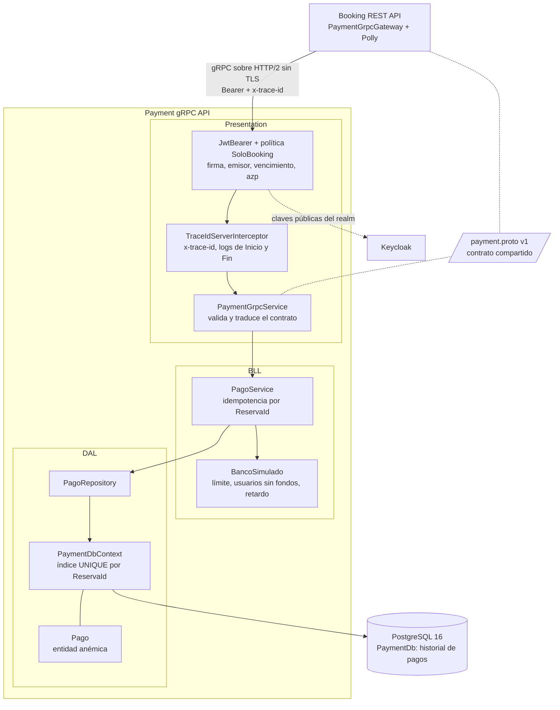
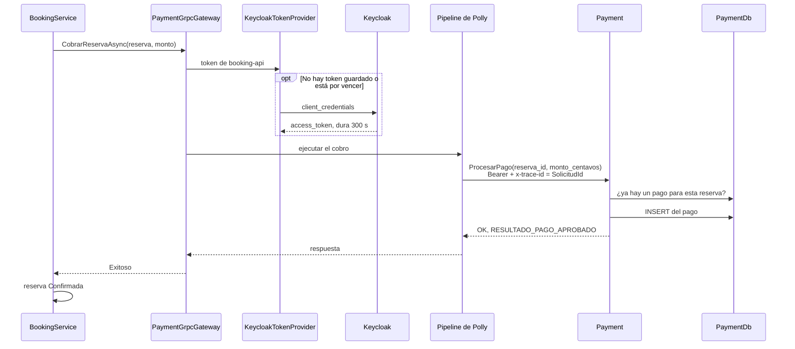
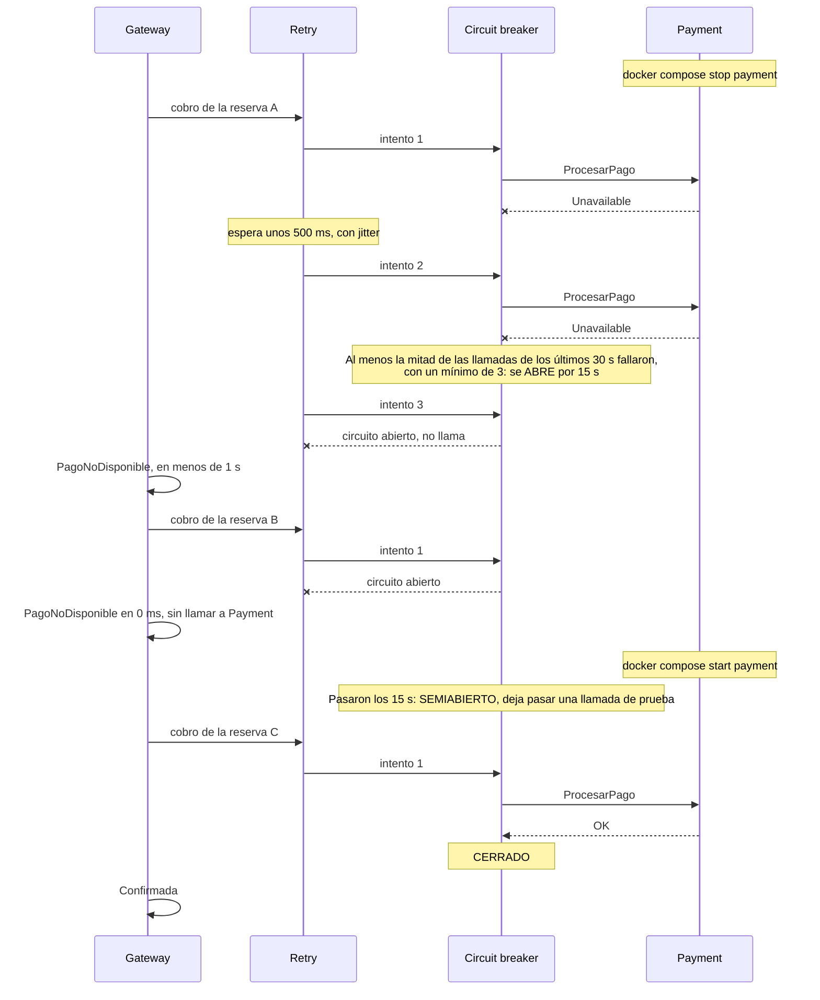

# Feature 3: cobro por gRPC y resiliencia

Documentación de la dupla 3 del Grupo 6. Cubre la **Payment gRPC API** (punto 3.c) y el **cliente con resiliencia en Booking** (punto 3.j), con la seguridad entre los dos servicios (3.e), la trazabilidad (3.f), el diagrama de arquitectura interna de Payment (3.i) y la frontera de consistencia entre las dos bases (3.g).

Cómo correr y configurar Payment está en [`TP-ProgramacionIV/PaymentAPI/README.md`](../TP-ProgramacionIV/PaymentAPI/README.md).

## Qué hace

1. Booking crea la reserva **Retenida** y llama a Payment por gRPC con el monto en centavos, su token de Keycloak y el `TraceId`.
2. Payment valida el token, decide con un banco simulado y guarda el cobro, aprobado o rechazado.
3. Booking confirma o rechaza según la respuesta:

| Respuesta de Payment | Estado de la reserva |
|---|---|
| Aprobado | **Confirmada** |
| Fondos insuficientes: Payment funcionó y dijo que no | **Rechazada** por **PagoFallido** |
| Payment caído, lento, el circuito abierto o cualquier falla técnica | **Rechazada** por **PagoNoDisponible** |

El último caso es la **degradación elegante**. El gateway nunca lanza una excepción: siempre devuelve un resultado, Booking sigue funcionando sin Payment y el mensaje de Service Bus se completa igual.

## Arquitectura interna de Payment (punto 3.i)

N-Layer con dominio anémico: la entidad `Pago` solo tiene datos y las reglas viven en la BLL. Cada capa depende de la de abajo, con una excepción: el enum `ResultadoPago` de DAL, que la BLL devuelve en `ResultadoPagoDto` y Presentation traduce al enum del contrato. Booking usa el mismo criterio con sus enums de estado.



## El cobro, paso a paso (punto 3.j)

### Caso normal



### Payment caído: reintentos, circuito abierto y recuperación



El momento exacto en que se abre depende de las llamadas anteriores de la ventana. Con dos cobros exitosos antes, alcanzan dos fallas: son 4 llamadas y la mitad falló.

### Payment lento: timeout por intento

Si Payment tarda más de 2 s, Polly cancela ese intento. La cancelación viaja hasta Payment, que corta el cobro antes de guardarlo, y Booking reintenta. Con un banco que tarda 3 s se hacen tres intentos de 2 s con dos esperas en el medio, unos 7 s, y la reserva termina en PagoNoDisponible porque Payment no respondió a tiempo. Si el circuito se abre en el medio, el último intento no se hace: en la evidencia, con un solo cobro exitoso previo en la ventana, se abrió después del segundo intento y la reserva quedó rechazada en 4,7 s. En ningún caso queda en la base de Payment un pago de esa reserva.

## Resiliencia en Booking

El pipeline de Polly v8 se arma una sola vez para toda la aplicación (Singleton). Si se armara uno por request, el circuit breaker empezaría limpio en cada cobro y nunca acumularía fallas. La primera versión del gateway armaba sus políticas en cada request y no tenía circuit breaker.

| Capa, de afuera hacia adentro | Valor | Por qué |
|---|---|---|
| Timeout total | 10 s | Tope de todo el cobro, reintentos incluidos. Queda muy por debajo del lock de 60 s del mensaje de Service Bus |
| Retry | 2 reintentos, espera exponencial desde 500 ms, máximo 2 s, con jitter | Solo ante `Unavailable` o timeout del intento. No se reintentan `Internal`, `DeadlineExceeded` ni `Unauthenticated`: repetirlos no cambia nada, o no se sabe si Payment ya cobró |
| Circuit breaker | Se abre con el 50 % de fallas en 30 s y un mínimo de 3 llamadas; corta 15 s | Si Payment viene fallando, rechaza al instante en lugar de hacer esperar cada reserva y cargar a un servicio caído |
| Timeout por intento | 2 s | Corta un intento colgado y cancela la llamada gRPC |

Los valores se configuran en la sección `ResilienciaPago` del `appsettings.json` de Booking. Hay dos ajustes del canal gRPC que importan para que esto funcione:

- **`ThrowOperationCanceledOnCancellation = true`.** Así una llamada cancelada llega como la excepción que reconoce el timeout de Polly. Sin esto, el intento vencido no se reintenta.
- **Reconexión cada 5 s como máximo.** Por defecto, con Payment caído el canal espera hasta 2 minutos entre intentos de conexión. Mientras espera, la llamada de prueba del circuito falla aunque Payment ya haya vuelto.

Los reintentos son seguros porque **Payment es idempotente**. El `reserva_id` tiene un índice UNIQUE: si un intento ya cobró y se perdió la respuesta, el reintento encuentra el pago y devuelve el mismo resultado. Si dos intentos llegan a la vez, la base frena al segundo.

## Seguridad entre servicios (punto 3.e)

- Booking pide su token a Keycloak con `client_credentials` (cliente `booking-api`) y lo guarda hasta 30 s antes de que venza. Si varios cobros lo necesitan a la vez, hacen un solo pedido.
- El token viaja en el header `authorization` de la metadata. Las `CallCredentials` de gRPC solo se mandan sobre TLS, y dentro de Docker la llamada va sin TLS.
- Payment valida siempre la firma, el emisor y el vencimiento, y exige `azp = booking-api`: otro cliente del realm, aunque tenga un token válido, recibe `PermissionDenied`.
- La audiencia `payment-api` se valida según el flag `Authentication:ValidateAudience`. Hoy los tokens del realm del grupo no traen `aud`, así que el compose la deja apagada hasta que se agregue el mapper. Payment lo avisa en el log al arrancar.

## Trazabilidad (punto 3.f)

Se sigue la convención de dupla 4 ([`docs/plantilla-de-logs.md`](plantilla-de-logs.md)): en el cobro, el `TraceId` es el `SolicitudId` y viaja en la metadata `x-trace-id`. En Payment aparece en todas las líneas de cada llamada, y además se guarda en cada fila de `Pagos`. En Booking lo llevan los logs del cobro: `PaymentGrpcGateway` y Polly (`ResilienciaPago`). El resto de Booking todavía no lo propaga: el listener de Service Bus registra el `TraceId` que trae el mensaje, o uno nuevo si no viene, y el publicador de eventos y el worker de vencimiento generan uno nuevo en cada evento. Eso queda para la dupla 2.

Un cobro real del escenario 7a de la evidencia. Payment registra la hora en UTC y Booking en hora argentina: 00:42 y 21:42 son el mismo momento.

```text
Booking  21:42:31.152 Inicio CobrarReserva TraceId=d42f52dd-8266-4f62-9490-1f398a50ff30 ReservaId=1735ae18-21b5-422b-83de-64f76575dd22 Monto=1500
Payment  00:42:31 INF [PaymentAPI] [TraceId=d42f52dd-8266-4f62-9490-1f398a50ff30] Inicio /payment.v1.PaymentService/ProcesarPago
Payment  00:42:31 INF [PaymentAPI] [TraceId=d42f52dd-8266-4f62-9490-1f398a50ff30] Pago f37d92a9-8125-4adb-925b-64b37818d8ab registrado para la reserva 1735ae18-21b5-422b-83de-64f76575dd22: Aprobado
Payment  00:42:31 INF [PaymentAPI] [TraceId=d42f52dd-8266-4f62-9490-1f398a50ff30] Fin /payment.v1.PaymentService/ProcesarPago Resultado=OK DuracionMs=376
Booking  21:42:31.790 Fin CobrarReserva TraceId=d42f52dd-8266-4f62-9490-1f398a50ff30 Resultado=Aprobado DuracionMs=638
```

## Frontera de consistencia entre Booking y Payment (punto 3.g)

La llamada a Payment es síncrona, pero hay dos bases. Si el último intento se corta justo después de que Payment guardó el pago, Booking rechaza la reserva mientras Payment tiene el cobro aprobado. La idempotencia cubre los intentos intermedios, no el último. En un sistema real esto se resuelve conciliando contra Payment, por ejemplo con un proceso que consulte los pagos de las reservas rechazadas por PagoNoDisponible. Para este TP queda documentado como el límite del diseño.

## Decisiones

| Tema | Decisión | Alternativa descartada |
|---|---|---|
| Contrato | Contract-first: un solo `.proto` en `TP-ProgramacionIV/Protos/payment/v1`, que comparten los dos proyectos | Una copia en cada proyecto, que se desincroniza |
| Plata | `int64 monto_centavos` | `double`, que no representa exacto valores como 0,10 |
| Banco | Simulado y determinístico, configurable | Resultado al azar, que no se puede repetir en la demo |
| Base de Payment | PostgreSQL 16 propio, sin puertos publicados | Compartir el servidor de Booking |
| Resiliencia | Pipeline de Polly v8 Singleton | Las políticas por request de la primera versión, sin circuit breaker |
| Estructura | Un proyecto con carpetas Presentation, BLL y DAL, como Booking | Un proyecto por capa |
| Token | `KeycloakTokenProvider` propio, con caché | Pedir un token por cobro |
| Idempotencia | `reserva_id` con índice UNIQUE | Sin clave: un reintento después de un timeout cobraría dos veces |
| Trazabilidad | Convención de dupla 4: `x-trace-id` = `SolicitudId` | Un identificador nuevo por llamada |
| Audiencia | Validada según un flag | Exigirla siempre, que hoy rechazaría todos los cobros |

## Demo

El proyecto [`TP-ProgramacionIV/DemoResiliencia`](../TP-ProgramacionIV/DemoResiliencia/Program.cs) usa el cliente de Booking, registrado igual que en Booking, sin Service Bus ni la base de Booking. Necesita Keycloak y Payment levantados, desde la raíz del repo; el resto del sistema no hace falta:

```bash
docker compose -f docker-compose.yml -f docker-compose.payment.yml up -d --build
```

```bash
export Authentication__ClientSecret=<secreto de booking-api>
cd TP-ProgramacionIV/DemoResiliencia
dotnet run
```

En modo interactivo, las opciones cobran una reserva de $1.500, una de $60.000 o cinco seguidas. Payment se apaga y se prende desde otra terminal, parado en la raíz del repo:

```bash
docker compose -f docker-compose.yml -f docker-compose.payment.yml stop payment
```

```bash
docker compose -f docker-compose.yml -f docker-compose.payment.yml start payment
```

Con `dotnet run -- --guion` recorre solo los escenarios de abajo.

## Evidencia

Salida de la demo en [`docs/evidencia/feature-3-escenarios.txt`](evidencia/feature-3-escenarios.txt), con las categorías de log acortadas (sin el namespace `BookingAPI.BLL.Gateways.`), y al final la consulta a la base de Payment. Payment corría en Docker, con un Keycloak 26.8.1 real y el token real de `booking-api`, el 02/11/2026, en un entorno descartable (proyecto de compose `payment-e2e`).

| # | Escenario | Resultado | Tiempo |
|---|---|---|---|
| 1 | Happy path, $1.500 | Confirmada | 261 ms |
| 2 | Fondos insuficientes, $60.000 con un límite de $50.000 | Rechazada por PagoFallido, sin reintentos | 14 ms |
| 3 | `stop payment` y una reserva | Reintenta, se abre el circuito y queda Rechazada por PagoNoDisponible | 772 ms |
| 4 | Otra reserva con el circuito abierto | Rechazada por PagoNoDisponible, sin llamar a Payment | 0 ms |
| 5 | `start payment` y pasados los 15 s | El circuito pasa a semiabierto, prueba una llamada, se cierra y confirma | 659 ms |
| 6 | Payment con un retardo de 3 s | Los dos primeros intentos se cortan a los 2 s, el circuito se abre antes del tercero y queda Rechazada por PagoNoDisponible | 4716 ms |
| 7 | Payment caído 60 s y después levantado | Mientras está caído, los cobros se rechazan en 0 ms sin llamar a Payment. Pasados los 15 s de cada corte, el cobro siguiente hace de llamada de prueba, falla y el circuito vuelve a abrirse: esos cobros tardan entre 96 y 658 ms. En la evidencia hubo una prueba cada 20 s, porque la demo cobra cada 10 s. La primera reserva confirmada sale 15,5 s después del `start` | — |

La consulta a la base de Payment, al final de la evidencia, muestra que solo quedaron pagos de los cobros que Payment llegó a procesar: los aprobados y el rechazado por fondos. Los intentos cortados del escenario 6 y los cobros con Payment caído no dejaron ninguno.

## Para integrarlo con el resto del grupo

Cuando Booking tenga su Dockerfile y su servicio en el compose, necesita estas variables:

| Variable | Valor |
|---|---|
| `GrpcSettings__PaymentServiceUrl` | `http://payment:8080` |
| `Authentication__TokenUrl` | `http://keycloak:8080/realms/booking-realm/protocol/openid-connect/token` |
| `Authentication__ClientSecret` | El secreto de `booking-api`, por variable de entorno y nunca en el repo |
| `Authentication__Authority` | `http://keycloak:8080/realms/booking-realm`, para que el `[Authorize]` de Booking baje las claves del realm por la red interna |
| `AzureServiceBus__ConnectionString` | La cadena de Service Bus, por variable de entorno y nunca en el repo |
| `ConnectionStrings__BookingDb` | Sumarle `GSS Encryption Mode=Disable`, por el mismo motivo que en Payment |

Del lado de Keycloak falta agregar al cliente `booking-api` un mapper de audiencia con `payment-api`, y exportar `booking-realm` al repo. El export que hay hoy es de `reservas-realm` y trae los secretos enmascarados: al importarlo, hay que regenerar el secreto de `booking-api`.
