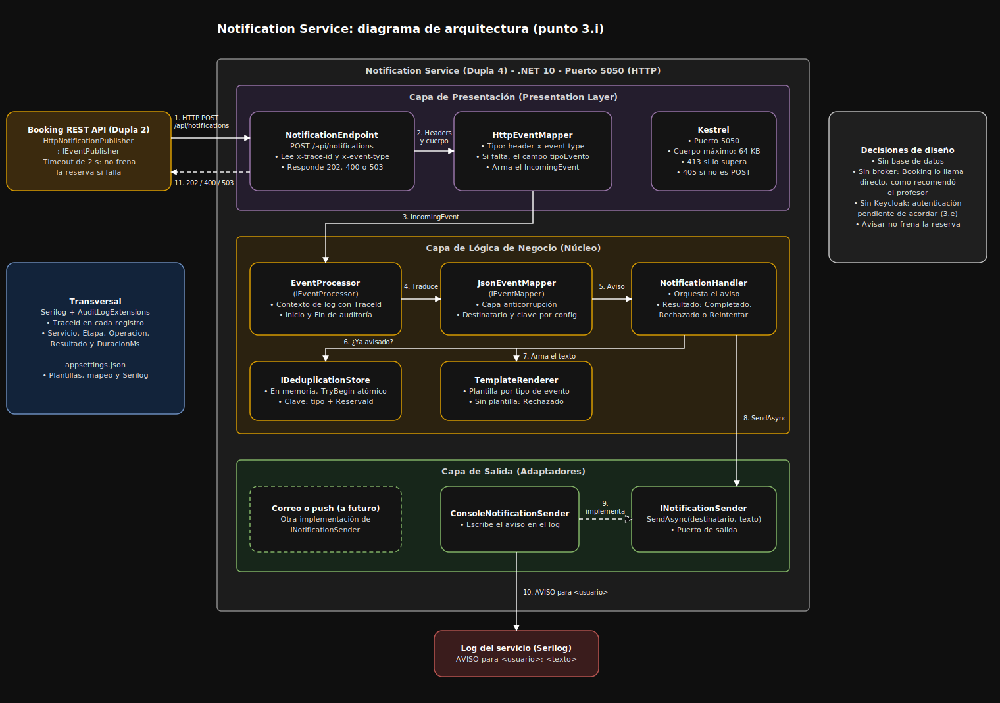

# Feature 4: Servicio de Notificaciones

Parte de la dupla 4 correspondiente al servicio de notificaciones (punto 3.h), con sus logs de auditoría y trazabilidad (3.f) y su diagrama de arquitectura (3.i). El código está en `TP-ProgramacionIV/NotificationService/`, sus pruebas en `TP-ProgramacionIV/NotificationService.Tests/` y la guía de uso en su [README](../TP-ProgramacionIV/NotificationService/README.md).

## Qué hace

Avisa al usuario cuando la reserva queda creada (`ReservaCreada`) y cuando se confirma tras el cobro (`ReservaConfirmada`). Lo llama Booking con un `POST /api/notifications`. Es un servicio independiente: no conoce reservas ni pagos, solo recibe un evento con el tipo de aviso, el destinatario y los datos, arma el texto con una plantilla y lo entrega. Hoy el aviso sale por el log del servicio.

No tiene base de datos, no usa broker y no llama a otros servicios. El profesor indicó que la API de notificación no es obligatoria en código y que, si se implementa, conviene una llamada HTTP directa desde Booking, sin mezclar tópicos de Service Bus para responsabilidades distintas. El diseño inicial leía de Service Bus y se pasó a HTTP por esa recomendación.

## Arquitectura (punto 3.i)



El diagrama editable está en [diagrama-notificaciones.drawio](diagramas/diagrama-notificaciones.drawio). Sigue una arquitectura de puertos y adaptadores en tres capas:

| Capa | Piezas | Responsabilidad |
|---|---|---|
| Presentación | `NotificationEndpoint`, `HttpEventMapper` | Único lugar que conoce HTTP: recibe la llamada, limita el cuerpo a 64 KB, arma el evento y traduce el resultado a un código de respuesta |
| Lógica de negocio | `EventProcessor`, `JsonEventMapper`, `NotificationHandler`, `TemplateRenderer`, `IDeduplicationStore` | Traduce el evento, descarta repetidos, arma el texto con la plantilla y decide el resultado |
| Salida | `INotificationSender`, `ConsoleNotificationSender` | Entrega el aviso. Se puede cambiar por mail o push sin tocar el núcleo |

## Contrato HTTP

| Parte | Detalle |
|---|---|
| Ruta | `POST /api/notifications` (puerto 5050) |
| Header `x-event-type` | `ReservaCreada` o `ReservaConfirmada`. Si falta, se usa `tipoEvento` del cuerpo |
| Header `x-trace-id` | Identificador de seguimiento. Si falta, se usa `traceId` del cuerpo |
| Cuerpo | JSON plano de hasta 64 KB: `tipoEvento`, `reservaId`, `solicitudId`, `asientoId`, `eventoId`, `usuarioId`, `estado`, `fechaCreacionUtc`, `fechaVencimientoUtc`, `fechaEventoUtc` y `traceId` |
| Respuestas | `202` aviso enviado o repetido descartado, `400` evento inválido, `405` método distinto de POST, `413` cuerpo demasiado grande y `503` falló el envío |

## Decisiones y patrones

Las decisiones están justificadas también en el código, en comentarios marcados con `[JUSTIFICACIÓN - ...]`.

| Decisión | Patrón o principio | Por qué |
|---|---|---|
| Entrada HTTP y salida por interfaces | Puertos y adaptadores, inversión de dependencias | El núcleo no sabe de HTTP ni de cómo se entrega el aviso |
| `JsonEventMapper` y `HttpEventMapper` | Capa anticorrupción | Lo que cambie en el formato del emisor se absorbe por configuración, sin tocar el núcleo |
| `NotificationHandler` | Responsabilidad única | Decide qué hacer con un aviso, sin conocer el transporte ni el formato |
| Plantillas y mapeo en `appsettings.json` | Patrón Options, abierto/cerrado | Un tipo de aviso nuevo es una plantilla más y no obliga a recompilar |
| `IDeduplicationStore` con reserva atómica de la clave | Idempotencia y concurrencia | Si quien llama reintenta, el usuario no recibe el mismo aviso dos veces, ni siquiera con llamadas simultáneas |
| `ProcessingResult` en lugar de excepciones | Resultado explícito | Cada caso (completado, reintentar, rechazado) lleva su motivo |
| Límite de 64 KB | Defensa | Una llamada mal formada no gasta memoria |

## Logs de auditoría y trazabilidad (punto 3.f)

Usa Serilog, configurado desde `appsettings.json`. Cada llamada abre un contexto con el `TraceId` (header `x-trace-id` o, si falta, el campo `traceId` del cuerpo), y todos los registros del procesamiento lo llevan, también los del manejador y los del envío. Cada llamada registra su inicio y su fin con los mismos campos de auditoría:

| Campo | Contenido |
|---|---|
| `Servicio` | `NotificationService` |
| `Etapa` | `Inicio` o `Fin` |
| `Operacion` | `ProcesarMensaje` |
| `TraceId` | El identificador de la cadena de sucesos |
| `Resultado` | `Completed`, `Retry` o `Rejected` |
| `DuracionMs` | Duración en milisegundos |

```text
21:45:13 INF [NotificationService] [TraceId=trace-red-1] Inicio ProcesarMensaje
21:45:13 INF [NotificationService] [TraceId=trace-red-1] AVISO para user-123: Tu reserva r-red-1 fue confirmada. ¡Gracias por tu compra!
21:45:13 INF [NotificationService] [TraceId=trace-red-1] Fin ProcesarMensaje Resultado=Completed DuracionMs=0
```

El `TraceId` se muestra con un `ExpressionTemplate`, porque `{TraceId}` es un nombre reservado en la plantilla de salida común de Serilog.

## Autenticación (punto 3.e)

El servicio puede exigir un token Bearer de Keycloak. Valida la firma, el emisor y el vencimiento, y que el cliente que llama (`azp`) esté permitido. Se activa con `Authentication__Enabled=true`. Viene apagada por defecto, porque el contrato acordado con Booking no incluye un token. Para encenderla, Booking tiene que pedir su token a Keycloak y mandarlo en el header `Authorization`. El detalle está en el README.

## Pruebas y evidencia

- **57 pruebas automáticas**, todas pasan: mapeo de eventos, plantillas, deduplicación, concurrencia (2000 eventos en secuencia, 2000 en paralelo y el mismo evento 20 veces a la vez), `TraceId` en los registros, el endpoint HTTP y la autenticación (sin token, con token válido y con token de otro cliente).
- **Prueba de humo**, `scripts/smoke-test.sh`: construye la imagen, levanta el servicio y le hace llamadas reales. Resultado:

```text
  OK    El notificador responde en http://127.0.0.1:5050
  OK    Un evento válido responde 202
  OK    El mismo evento repetido responde 202
  OK    Avisó una sola vez al usuario
  OK    Los registros llevan el TraceId de la cabecera
  OK    Un cuerpo inválido responde 400
  OK    El rechazo queda en el log
  OK    Un cuerpo de más de 64 KB responde 413
  OK    GET responde 405
```

## Cómo ejecutarlo

```bash
dotnet run --project TP-ProgramacionIV/NotificationService
dotnet test TP-ProgramacionIV/NotificationService.Tests/NotificationService.Tests.csproj
./scripts/smoke-test.sh
```

## Límites conocidos

- La memoria de avisos enviados vive en un solo proceso: con más de una instancia habría que moverla a un almacén compartido, y se pierde al reiniciar.
- El aviso sale por el log. Un envío real por mail o push es una clase más que implemente `INotificationSender`.
- La llamada es directa: si el notificador está caído, Booking lo registra y la reserva sigue, pero ese aviso no se reenvía.
